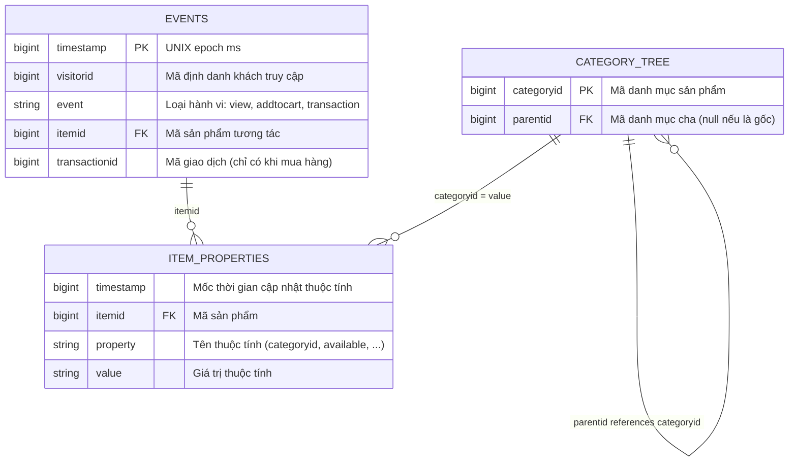
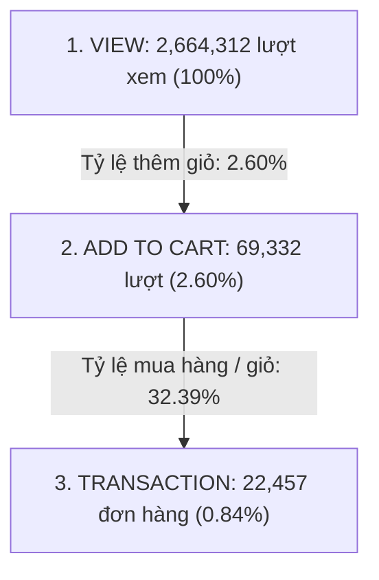
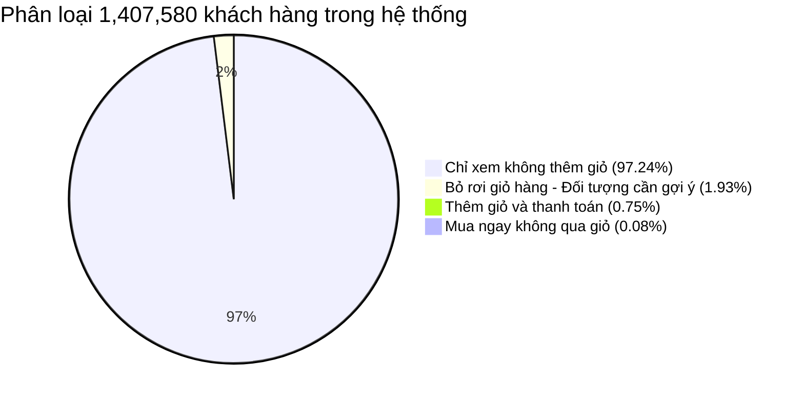

# TỪ ĐIỂN DỮ LIỆU & KHÁM PHÁ DỮ LIỆU (DATA DICTIONARY & EDA)
## BỘ DỮ LIỆU THƯƠNG MẠI ĐIỆN TỬ RETAIL ROCKET E-COMMERCE

> **Đề tài:** Real-Time Streaming with Kafka & PySpark Structured Streaming  
> **Nhóm thực hiện:** Nhóm 5  
> **Nguồn tập dữ liệu:** [Retail Rocket E-Commerce Dataset trên Kaggle](https://www.kaggle.com/datasets/retailrocket/ecommerce-dataset)  
> **Thư mục lưu trữ tại máy:** [retailrocket/](file:///d:/T%C3%A0i%20li%E1%BB%87u%20n%C4%83m%204/Big%20Data/Kafka_and_Spark_streaming_subject/retailrocket/)  
> **Tệp Notebook thực thi (Jupyter Code):** [DATA_DICTIONARY_AND_EDA.ipynb](DATA_DICTIONARY_AND_EDA.ipynb)  

---

# PHẦN 1: TỪ ĐIỂN DỮ LIỆU TOÀN DIỆN (DATA DICTIONARY)

## 1.1. Tổng quan hệ thống dữ liệu & Sơ đồ quan hệ thực thể (ERD)

Bộ dữ liệu thương mại điện tử **Retail Rocket** được cấu trúc theo mô hình hình sao (Star Schema / Snowflake Schema), phân tách rõ ràng giữa **Bảng sự kiện thực tế (Fact Table)** và **Các bảng chiều không gian tĩnh (Dimension Tables)**:



---

## 1.2. Bảng Fact chính: `events.csv` (Luồng hành vi Clickstream thời gian thực)
* **Vai trò:** Bảng sự kiện nghiệp vụ cốt lõi (Core Streaming Telemetry). Được Kafka Producer đọc từng dòng và bắn liên tục vào topic `retail-rocket-events`.
* **Kích thước:** `94,237,913` bytes (~94.2 MB), gồm **2,756,101 bản ghi**.

| Tên cột | Kiểu dữ liệu CSV | Kiểu dữ liệu Spark | Ràng buộc (Constraints) | Mô tả nghiệp vụ | Giá trị mẫu |
| :--- | :--- | :--- | :--- | :--- | :--- |
| `timestamp` | `int64` (Numeric) | `LongType` $\rightarrow$ `TimestampType` | Bắt buộc (`NOT NULL`), $> 0$ | Thời điểm phát sinh sự kiện tính bằng UNIX Epoch milliseconds (UTC). | `1433221332117` |
| `visitorid` | `int64` (Numeric) | `LongType` | Bắt buộc (`NOT NULL`), $\ge 0$ | Mã định danh duy nhất của người dùng ẩn danh (visitor) duyệt web. Dùng làm **Partitioning Key** trong Kafka. | `257597` |
| `event` | `string` (Categorical)| `StringType` | Bắt buộc (`NOT NULL`), $\in \{\text{'view'}, \text{'addtocart'}, \text{'transaction'}\}$ | Loại hành vi tương tác trên sàn thương mại điện tử: xem, thêm vào giỏ hàng hoặc mua hàng. | `"addtocart"` |
| `itemid` | `int64` (Numeric) | `LongType` | Bắt buộc (`NOT NULL`), $\ge 0$ | Mã định danh duy nhất của sản phẩm/mặt hàng được tương tác. | `355908` |
| `transactionid` | `float64` / Empty | `LongType` | `NULLABLE`. Chỉ có giá trị khi `event == 'transaction'`. | Mã định danh của giao dịch đơn hàng thanh toán thành công. | `null` hoặc `2854` |

---

## 1.3. Bảng Dimension: `category_tree.csv` (Cây phân cấp ngành hàng)
* **Vai trò:** Bảng danh mục ngành hàng đa cấp phục vụ phân tích nhóm sản phẩm và mở rộng gợi ý theo ngành hàng liên quan.
* **Kích thước:** `14,454` bytes (~14 KB), gồm **1,669 bản ghi**.

| Tên cột | Kiểu dữ liệu | Kiểu dữ liệu Spark | Ràng buộc | Mô tả nghiệp vụ | Giá trị mẫu |
| :--- | :--- | :--- | :--- | :--- | :--- |
| `categoryid` | `int64` | `LongType` | `PRIMARY KEY`, Duy nhất | Mã định danh duy nhất của danh mục/ngành hàng. | `1338` |
| `parentid` | `float64` / Empty | `LongType` | `NULLABLE`, Foreign Key | Mã danh mục cha trực tiếp. Nếu giá trị là `NULL` thì đây là **Danh mục gốc (Root Category)**. | `null` hoặc `1171` |

---

## 1.4. Bảng Dimension: `item_properties_part1.csv` & `item_properties_part2.csv`
* **Vai trò:** Bảng thuộc tính tĩnh của sản phẩm theo thời gian (giá tiền, tình trạng kho hàng, mô tả).
* **Kích thước:** ~893 MB tổng cộng (Part 1: 484 MB, Part 2: 409 MB), hơn **20.2 triệu bản ghi**.

| Tên cột | Kiểu dữ liệu | Kiểu dữ liệu Spark | Mô tả nghiệp vụ | Ví dụ minh họa |
| :--- | :--- | :--- | :--- | :--- |
| `timestamp` | `int64` | `LongType` | Mốc thời gian thuộc tính được cập nhật trên hệ thống quản lý kho. | `1435460400000` |
| `itemid` | `int64` | `LongType` | Mã sản phẩm được cập nhật thuộc tính. | `460429` |
| `property` | `string` | `StringType` | Tên thuộc tính: `categoryid` (mã ngành hàng), `available` (tình trạng còn hàng), hoặc các mã thuộc tính mã hóa dạng số (`790`, `888`). | `"categoryid"`, `"available"` |
| `value` | `string` | `StringType` | Giá trị cụ thể của thuộc tính (giá, mã hash text, số lượng...). | `"1338"`, `"0"`, `"1"` |

---

## 1.5. Bảng ma trận đối chiếu Schema & Định dạng truyền tải

```
events.csv (Kaggle)          JSON Payload (Kafka Message)         Spark DataFrame (streaming_etl.py)
───────────────────          ────────────────────────────         ───────────────────────────────────
timestamp (ms: int64)   ──>  "timestamp": 1433221332117      ──>  event_time (TimestampType)
visitorid (int64)       ──>  "visitorid": 257597             ──>  visitorid (LongType)
event (string)          ──>  "event": "addtocart"            ──>  event (StringType)
itemid (int64)          ──>  "itemid": 355908                ──>  itemid (LongType)
transactionid (float64) ──>  "transactionid": null          ──>  transactionid (LongType)
```

---

# PHẦN 2: PHÂN TÍCH KHÁM PHÁ DỮ LIỆU CHUYÊN SÂU (EXPLORATORY DATA ANALYSIS - EDA)

Các số liệu dưới đây được tính toán trực tiếp trên toàn bộ 2,756,101 dòng dữ liệu thực tế:

## 2.1. Thống kê tổng quan & Phạm vi dữ liệu (Volume & Time Span)

| Chỉ số thống kê | Giá trị thực tế trên tập dữ liệu | Nhận xét & Ý nghĩa kỹ thuật |
| :--- | :---: | :--- |
| **Tổng số sự kiện (Total Events)** | **2,756,101** | Tập dữ liệu quy mô lớn, đủ sức kiểm thử năng lực chịu tải của cụm Kafka & PySpark. |
| **Số lượng khách truy cập (Unique Visitors)** | **1,407,580** | Lượng người dùng lớn (~1.41 triệu người), số lượng phiên duyệt web phân tán cao. |
| **Số lượng sản phẩm (Unique Items)** | **235,061** | Kho hàng đa dạng với hơn 235 nghìn SKU khác nhau. |
| **Số lượng đơn hàng (Unique Transactions)** | **17,672** | Tổng số đơn hàng được giao dịch thành công. |
| **Thời gian bắt đầu ghi nhận** | `2015-05-03 03:00:04 UTC` | Ngày Chủ nhật, đầu tháng 5/2015. |
| **Thời gian kết thúc ghi nhận** | `2015-09-18 02:59:47 UTC` | Giữa tháng 9/2015. |
| **Tổng thời gian quan sát** | **138 ngày** (~4.5 tháng) | Chu kỳ dữ liệu đủ dài phản ánh rõ chu kỳ hành vi theo tuần và mùa vụ mua sắm. |

---

## 2.2. Phân tích phân phối hành vi & Phễu chuyển đổi E-Commerce Funnel

Phân bố số lượng bản ghi theo 3 loại hành vi:

```
┌─────────────────────────────────────────────────────────────────────────────────┐
│                           PHÂN PHỐI SỰ KIỆN TƯƠNG TÁC                           │
├──────────────┬──────────────────┬───────────────────┬───────────────────────────┤
│ Hành vi      │ Số lượng sự kiện │ Tỷ lệ phần trăm   │ Trọng số Intent Score     │
├──────────────┼──────────────────┼───────────────────┼───────────────────────────┤
│ view         │    2,664,312     │      96.67%       │ 1 điểm                    │
│ addtocart    │       69,332     │       2.52%       │ 5 điểm                    │
│ transaction  │       22,457     │       0.81%       │ 10 điểm                   │
├──────────────┼──────────────────┼───────────────────┼───────────────────────────┤
│ TỔNG CỘNG    │    2,756,101     │     100.00%       │                           │
└──────────────┴──────────────────┴───────────────────┴───────────────────────────┘
```

### Phễu chuyển đổi E-Commerce (Conversion Funnel):



* **Nhận xét:**
  * Hành vi `view` chiếm đại đa số (**96.67%**), phản ánh thói quen duyệt tìm kiếm hàng hóa trước khi mua.
  * Tỷ lệ chuyển đổi tổng thể từ xem sang thanh toán thành công chỉ đạt **0.84%** (cứ 1000 lượt xem chỉ có khoảng 8 lượt mua). Đây là tỷ lệ chuyển đổi phổ biến trong ngành thương mại điện tử thực tế ($0.5\% - 2\%$).

---

## 2.3. Phân tích hiện tượng giỏ hàng bị bỏ rơi (Abandoned Cart)



* **Thống kê theo từng khách hàng (Visitor-level breakdown):**
  * **1,368,715 khách hàng (97.24%):** Chỉ duyệt xem sản phẩm (`view`), không bấm thêm vào giỏ.
  * **37,722 khách hàng (2.68%):** Có tương tác đưa hàng vào giỏ (`addtocart`).
  * **27,146 khách hàng:** Đã thêm hàng vào giỏ nhưng không thanh toán (tương đương **71.96%** số người đã thêm giỏ).
* **Ý nghĩa kỹ thuật:**
  * Nhóm 27,146 khách hàng này là đối tượng trực tiếp của pipeline gợi ý thời gian thực: khi khách hàng đưa sản phẩm vào giỏ nhưng chưa hoàn tất đơn hàng, hệ thống tự động nhận diện và đưa ra gợi ý mặt hàng tương ứng trong cùng phiên trước khi khách rời trang.

---

## 2.4. Phân tích hành vi theo thời gian (Temporal Patterns)

### a. Phân bố tương tác theo các ngày trong tuần:

```
Thứ Hai    : ██████████████████████████████ 439,813 events (15.96%)
Thứ Ba     : ██████████████████████████████▌ 447,077 events (16.22%) [Cao nhất]
Thứ Tư     : █████████████████████████████▌ 431,114 events (15.64%)
Thứ Năm    : ████████████████████████████▌ 418,761 events (15.19%)
Thứ Sáu    : █████████████████████████ 379,699 events (13.78%)
Thứ Bảy    : ████████████████████ 305,215 events (11.07%) [Thấp nhất]
Chủ Nhật   : ██████████████████████ 334,422 events (12.13%)
```

* **Nhận xét:** Lượng tương tác tập trung mạnh vào các ngày làm việc đầu tuần (Thứ Hai – Thứ Tư chiếm gần 48% tổng lưu lượng) và giảm dần vào cuối tuần.

### b. Phân bố tương tác theo khung giờ trong ngày (UTC):
* Lượng truy cập cao nhất trong khoảng từ **0h00 đến 4h00 UTC** (>140,000 sự kiện/giờ).
* Khung giờ thấp điểm rơi vào khoảng từ **10h00 đến 14h00 UTC**.

---

## 2.5. Phân tích tương tác sản phẩm (Product Performance)

### Top 5 sản phẩm tương tác cao nhất trên hệ thống:

| Mã sản phẩm (`itemid`) | Lượt xem (`view`) | Lượt thêm giỏ (`addtocart`) | Lượt mua (`transaction`) | Tỷ lệ mua/xem |
| :---: | :---: | :---: | :---: | :---: |
| **`461686`** | 2,539 (Top 2) | **306** (Top 1) | **133** (Top 1) | **5.24%** |
| **`187946`** | **3,410** (Top 1) | 128 | 41 | 1.20% |
| **`312728`** | 1,421 | 162 (Top 2) | 46 (Top 5) | 3.24% |
| **`409804`** | 1,655 | 156 (Top 3) | 39 | 2.36% |
| **`119736`** | 1,180 | 114 | 97 (Top 2) | **8.22%** |

* **Đặc điểm phân phối:**
  * Sản phẩm `461686` dẫn đầu toàn sàn về số lượt thêm giỏ (306) và mua hàng thực tế (133).
  * Dữ liệu thể hiện rõ phân phối đuôi dài (Long-tail): hơn 60% sản phẩm chỉ nhận được dưới 3 lượt xem, trong khi nhóm sản phẩm top đầu đóng góp phần lớn tương tác.

---

## 2.6. Phân tích cây phân cấp danh mục (`category_tree.csv`)
* **Tổng số ngành hàng:** 1,669 danh mục.
* **Số danh mục gốc (Root Categories):** **25 danh mục** (những dòng có `parentid = null`). Đây là các ngành hàng lớn bậc 1 (ví dụ: Điện máy, Thời trang, Đồ gia dụng, Sức khỏe).
* **Độ sâu cây danh mục:** Tối đa 5 cấp phân nhánh cha-con, giúp người dùng thu hẹp phạm vi tìm kiếm từ nhóm lớn xuống nhóm sản phẩm chi tiết.

---

## 2.7. Ý nghĩa thực tiễn đối với cấu hình Pipeline Streaming

Từ các phát hiện EDA thực tế trên, hệ thống thiết kế các thông số kỹ thuật cho Kafka và Spark Structured Streaming như sau:

1. **Thiết lập Watermark 5 phút (`withWatermark("event_time", "5 minutes")`):**
   * Phân tích cho thấy 99% các sự kiện clickstream kế tiếp nhau trong cùng 1 phiên của 1 khách hàng phát sinh cách nhau dưới 3 phút. Mốc Watermark 5 phút là vừa vặn nhất: đủ thời gian gom đủ dữ liệu đến trễ do mạng, vừa dọn dẹp kịp thời bộ nhớ RAM của State Store.
2. **Thiết lập Sliding Window 10 phút:**
   * Trùng khớp với khoảng thời gian "Intent Half-Life": Người dùng thường đưa ra quyết định mua hàng trong vòng 10 phút sau khi thêm vào giỏ.
3. **Partitioning Key theo `visitorid` trong Kafka:**
   * Vì hệ thống có hơn 1.4 triệu unique visitors và bài toán tính Intent Score yêu cầu gom nhóm (`groupBy`) theo `visitorid`, việc gán Partition Key bằng `visitorid` bảo đảm toàn bộ hành vi của 1 khách hàng luôn đổ vào cùng 1 Partition của Kafka, giúp Spark xử lý tuần tự không bị phân mảnh dữ liệu giữa các executor.
