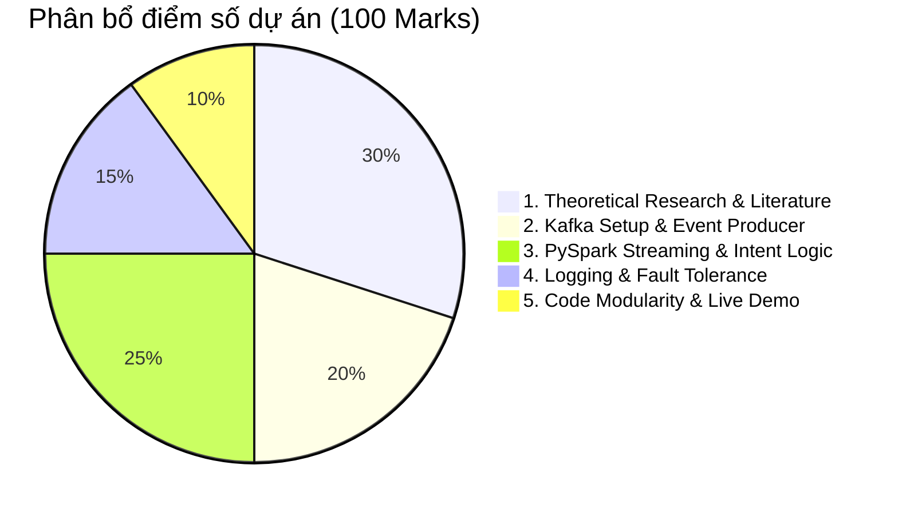

# BẢN LÀM MỊN YÊU CẦU ĐỀ TÀI: REAL-TIME STREAMING WITH KAFKA & SPARK STREAMING

> **Tài liệu nguồn:** `kafka_spark_streaming_subject.docx`  
> **Bộ dữ liệu:** Retail Rocket E-Commerce Events Dataset (`events.csv`)  
> **Nhóm thực hiện:** Nhóm Big Data (Phân nhánh: `dong`)  
> **Ngày cập nhật:** 26/10/2026  

---

## 1. TỔNG QUAN & BỐI CẢNH ĐỀ TÀI

### 1.1. Bối cảnh & Mục tiêu cốt lõi
* Khác với xử lý theo lô định kỳ (Batch Orchestration như Apache Airflow) xử lý dữ liệu tĩnh theo lịch trình, các hệ sinh thái doanh nghiệp hiện đại đòi hỏi tốc độ xử lý sự kiện dưới 1 giây (sub-second event processing) cho các bài toán: phát hiện gian lận (fraud detection), đo lường số liệu tức thời (real-time metrics), và cá nhân hóa trải nghiệm người dùng (live personalization).
* Mục tiêu của đề tài: Xây dựng một **End-to-End Real-Time Data Streaming Pipeline** hoàn chỉnh:
  * **Apache Kafka:** Thu nhận và phân phối sự kiện truy cập (Clickstream Ingestion & Partitioning).
  * **PySpark Structured Streaming:** Biến đổi luồng liên tục, tính toán điểm ý định mua hàng có trạng thái (Stateful Intent Scoring), ghi log vi mô và kích hoạt gợi ý sản phẩm tức thời (Real-time Recommendation).
  * **Storage & Monitoring:** Lưu trữ dữ liệu tinh chế có phân vùng (Parquet/Delta Lake) kèm Checkpointing chịu lỗi và Console Sink phục vụ giám sát trực tiếp.

```
┌─────────────────┐      ┌─────────────────────────┐      ┌─────────────────────────────┐      ┌─────────────────────────┐
│ Event Producer  │ ───> │     Apache Kafka        │ ───> │  PySpark Structured Stream  │ ───> │ Storage / Real-time UI  │
│ (Retail Rocket) │      │ (Topics / Partitioning) │      │  (Transform & Intent ML)    │      │ (Parquet / Console)     │
└─────────────────┘      └─────────────────────────┘      └─────────────────────────────┘      └─────────────────────────┘
```

### 1.2. Đặc tả dữ liệu đầu vào (Dataset Specification)
* **Nguồn:** Retail Rocket E-Commerce Dataset (Kaggle).
* **Tập tin mục tiêu:** `events.csv` (~2.75 triệu sự kiện tương tác của người dùng).
* **Cấu trúc Schema chuẩn:**
  1. `timestamp` *(UNIX Epoch milliseconds)*: Thời điểm chính xác sự kiện phát sinh.
  2. `visitorid` *(Integer)*: Định danh duy nhất của khách truy cập.
  3. `event` *(String)*: Loại hành vi tương tác, gồm 3 giá trị: `view`, `addtocart`, `transaction`.
  4. `itemid` *(Integer)*: Định danh duy nhất của sản phẩm được tương tác.
  5. `transactionid` *(Integer / Null)*: Mã định danh giao dịch (chỉ có giá trị khi `event = transaction`, còn lại là `null`).

---

## 2. BÓC TÁCH & LÀM MỊN CHI TIẾT YÊU CẦU THEO HẠNG MỤC

### 📌 PHẦN A: NỀN TẢNG LÝ THUYẾT & NGHIÊN CỨU HỌC THUẬT (30 ĐIỂM)

Yêu cầu trình bày chuyên sâu, có trích dẫn học thuật trong báo cáo kỹ thuật (`REPORT.md`):

#### 1. Kiến trúc Spark Streaming (Architecture of Spark Streaming)
* **DStream vs. Structured Streaming:**
  * So sánh mô hình RDD micro-batching truyền thống (DStream) với mô hình Bảng vô hạn (**Unbounded Table**) của Structured Streaming.
  * Phân tích sự vượt trội trong cơ chế xử lý theo thời gian sự kiện (**Event-Time**) và **Watermarking** so với Processing-Time của DStream.
  * Lợi thế từ việc tận dụng công cụ tối ưu hóa truy vấn **Catalyst Optimizer** và cơ chế thực thi bộ nhớ **Tungsten**.
* **Kiến trúc dữ liệu ETL trong Spark Streaming:**
  * Tầm quan trọng của ETL liên tục trong hệ thống xử lý luồng thời gian thực.
  * Cách thức Spark Streaming bảo đảm chất lượng ETL qua:
    * Ép buộc cấu trúc (**Schema Enforcement**).
    * Biến đổi trạng thái phân tán (**Stateful Transformations**).
    * Khả năng chịu lỗi cao (**Fault Tolerance**) thông qua Write-Ahead Logs (WAL) và Checkpointing.
    * Ngữ nghĩa đảm bảo chính xác một lần từ đầu đến cuối (**End-to-End Exactly-Once Semantics**).
* **Tổng quan tài liệu nghiên cứu (Literature Review):**
  * Tóm tắt và trích dẫn bài báo khoa học về tối ưu hóa xử lý ETL dạng luồng (ví dụ: bài báo gốc về *Structured Streaming* công bố tại ACM SIGMOD 2018).

#### 2. Hệ thống gợi ý với Spark Streaming (Recommender Systems)
* Phân tích ưu thế của hệ thống gợi ý thời gian thực so với gợi ý theo lô (Batch Recommendations): Cập nhật mô hình và hành vi tức thì, tránh trễ dữ liệu hàng giờ/ngày.
* Phương pháp phân tích chuỗi nhấp chuột (**Clickstream: `view`, `addtocart`**) trong PySpark Structured Streaming để tính toán **Intent Score** động và kích hoạt khuyến nghị sản phẩm tức thì trước khi người dùng thoát phiên (session termination).

#### 3. Thu nhận dữ liệu phân tán thời gian thực: Kafka vs. Flume
* **Apache Kafka Deep-Dive:**
  * Định nghĩa và nguyên lý hoạt động của các thành phần cốt lõi: Brokers, Topics, Partitions, Producers, Consumers, Consumer Groups.
  * Cơ chế đồng thuận **KRaft consensus** (loại bỏ phụ thuộc Zookeeper) so với mô hình Zookeeper truyền thống.
  * Đánh giá ưu và nhược điểm của Kafka trong bài toán Big Data.
  * Cơ chế tích hợp trực tiếp với Spark Streaming thông qua connector `spark-sql-kafka-0-10`.
* **Ma trận so sánh Kafka vs. Apache Flume:**
  * So sánh đối đầu về: Kiến trúc, cơ chế Pull/Push, khả năng chịu tải (Throughput), tính sẵn sàng, độ trễ và trường hợp sử dụng phù hợp.

---

### 📌 PHẦN B: HIỆN THỰC KỸ THUẬT & DEMO THỰC TẾ (70 ĐIỂM)

#### 1. Kịch bản nghiệp vụ (Concrete Business Scenario)
* Xây dựng **Real-Time E-Commerce Session Tracker & Personalization Engine**:
  * Tiếp nhận luồng sự kiện liên tục từ Kafka.
  * Theo dõi ý định người dùng trong bộ nhớ cửa sổ trượt (sliding window memory).
  * Ghi nhận các chỉ số hiệu năng ở cấp độ micro-batch.
  * Tự động kích hoạt gợi ý sản phẩm khi phát hiện người dùng có ý định mua hàng cao (**đã có `addtocart` nhưng chưa thực hiện `transaction`**).

#### 2. Chi tiết các nhiệm vụ lập trình (Pipeline Tasks)

##### Task 1: Bộ phát sự kiện Kafka (`producer.py`)
* Sử dụng thư viện Python: `kafka-python` hoặc `confluent-kafka`.
* Đọc dữ liệu từ `retailrocket/events.csv` theo từng dòng (hoặc chế độ giả lập phiên người dùng tương tác thực tế).
* Đẩy tin nhắn vào Kafka Topic: `retail-rocket-events`.
* Chuẩn hóa định dạng JSON Payload gửi đi:
  ```json
  {
    "timestamp": 1433221332117,
    "visitorid": 257597,
    "event": "addtocart",
    "itemid": 355908,
    "transactionid": null
  }
  ```
* Hỗ trợ điều tiết tốc độ (Streaming Interval Pacing) thông qua tham số (ví dụ: `--interval 0.1` giây) để kiểm soát tốc độ phát dữ liệu.
* Sử dụng `visitorid` làm Partitioning Key để đảm bảo tính tuần tự của sự kiện theo từng khách hàng.

##### Task 2: Hạ tầng cụm Apache Kafka
* Triển khai cụm Kafka bằng Docker Compose (chạy chế độ KRaft mode gọn nhẹ, không cần Zookeeper container).
* Tạo sẵn topic `retail-rocket-events` với **tối thiểu 2 Partitions** để minh họa khả năng đọc song song của các Spark executor/consumer tasks.
* Cấu hình port mapping: `localhost:9092` cho host ngoài và `kafka:19092` cho nội bộ mạng Docker.

##### Task 3: Đường ống xử lý PySpark Structured Streaming (`streaming_etl.py`)
* **Trích xuất (Extract):** Kết nối Kafka broker qua `spark.readStream` format `kafka`, subscribe topic `retail-rocket-events`.
* **Biến đổi & Watermarking (Transform & Watermarking):**
  * Parse chuỗi JSON thành các cột DataFrame tường minh bằng `from_json`.
  * Chuyển đổi `timestamp` từ UNIX epoch milliseconds sang Spark `TimestampType` (`event_time`).
  * **Cửa sổ trượt & Watermark (Theo đúng yêu cầu đề bài):**
    * Áp dụng **Sliding Window 10 phút** (`F.window("event_time", "10 minutes", "1 minute")` hoặc `"2 minutes"`).
    * Áp dụng **Watermark 5 phút** (`withWatermark("event_time", "5 minutes")`) để xử lý dữ liệu đến trễ và dọn dẹp trạng thái bộ nhớ.
* **Logic tính điểm ý định mua hàng & Kích hoạt gợi ý (Intent Scoring & Recommendation Logic):**
  * Gán trọng số tương tác hành vi:
    $$\text{view} = 1, \quad \text{addtocart} = 5, \quad \text{transaction} = 10$$
  * Tính điểm tổng hợp lũy kế (**Intent Score**) theo cặp `(visitorid, itemid)` trong cửa sổ hoạt động:
    $$\text{Intent Score} = (\text{views} \times 1) + (\text{carts} \times 5) + (\text{transactions} \times 10)$$
  * **Điều kiện kích hoạt gợi ý (Trigger Recommendation):**
    * Lọc khách hàng có hành vi thêm giỏ hàng nhưng chưa thanh toán: $\text{carts} > 0 \land \text{transactions} = 0 \land \text{Intent Score} \ge 5$.
    * Đưa ra đề xuất sản phẩm tức thì (`recommended_itemid`) và gán trạng thái `recommend`.
* **Ghi log có cấu trúc (Structured Logging):**
  * Triển khai micro-batch logging bằng `.foreachBatch()` hoặc kế thừa `StreamingQueryListener`.
  * Ghi nhận và xuất ra console / file JSON các chỉ số vi mô:
    * `Batch ID`
    * `Record count` (`numInputRows`)
    * `Execution time` / `Trigger latency` (ms)
    * `Watermark` và `State Memory Bytes`
* **Lưu trữ dữ liệu (Load / Sink & Fault Tolerance):**
  * **Console Sink:** Hiển thị trực tiếp bảng kết quả cập nhật (`outputMode("update")`) ra màn hình terminal phục vụ demo trên lớp.
  * **Curated Data Sink:** Lưu trữ kết quả xuống định dạng **Parquet** hoặc **Delta Lake** có phân vùng.
  * **Checkpointing:** Bắt buộc cấu hình `checkpointLocation` để lưu trạng thái, bảo đảm khả năng phục hồi nguyên vẹn khi khởi động lại pipeline (Fault Tolerance).

---

## 3. DANH MỤC SẢN PHẨM BÀN GIAO (DELIVERABLES)

| STT | Tên sản phẩm | Định dạng / Vị trí | Yêu cầu chi tiết |
| :---: | :--- | :--- | :--- |
| **1** | **Git Repository** | URL Git (GitHub) | Mã nguồn toàn bộ dự án, cấu trúc module chuyên nghiệp, commit history rõ ràng. |
| **2** | **Báo cáo kỹ thuật** | `REPORT.md` | Báo cáo hoàn chỉnh: Lý thuyết Part A, trích dẫn bài báo khoa học, ma trận Kafka vs Flume, sơ đồ kiến trúc và hướng dẫn cài đặt/vận hành step-by-step. |
| **3** | **Cấu hình Docker** | `docker-compose.yml` | Khởi động 1 lệnh chạy trơn tru Kafka (KRaft mode), tự tạo topic $\ge 2$ partitions và Spark ETL. |
| **4** | **Script Producer** | `producer.py` | Đọc `events.csv`, bắn message chuẩn JSON schema, có pacing và demo session. |
| **5** | **Script Streaming ETL** | `streaming_etl.py` | Pipeline PySpark Structured Streaming chuẩn spec: Watermark 5m, Window 10m, Intent Scoring, Recommender, Logging và Parquet Sink + Checkpoint. |
| **6** | **Slide Thuyết trình** | Slide (PDF / PPTX) | Bộ slide khoảng 15–20 trang trực quan, súc tích phục vụ báo cáo. |
| **7** | **Live Demo trên lớp** | 10–15 phút | Trình diễn trực tiếp trên máy: Khởi động cụm $\rightarrow$ chạy Spark $\rightarrow$ Producer gửi dữ liệu $\rightarrow$ Spark in log và gợi ý realtime. |

---

## 4. MA TRẬN THÔNG SỐ KỸ THUẬT CHUẨN (TECHNICAL SPECIFICATIONS)

| Thành phần | Thuộc tính / Tham số | Giá trị chuẩn quy định |
| :--- | :--- | :--- |
| **Dataset** | Tệp dữ liệu | `retailrocket/events.csv` (~2.75M records) |
| **Kafka Broker** | Image / Phiên bản | `apache/kafka:4.3.1` (KRaft Mode, không dùng Zookeeper) |
| **Kafka Topic** | Tên Topic / Partitions | `retail-rocket-events` / **Tối thiểu 2 Partitions** |
| **Kafka Ports** | Port Host / Port Container | `localhost:9092` (Host) / `kafka:19092` (Internal) |
| **Spark Runtime** | Image / Phiên bản | `apache/spark:4.2.0-python3` (hoặc Spark 3.5.x) |
| **Spark Package** | Connector Kafka | `org.apache.spark:spark-sql-kafka-0-10_2.13:4.2.0` |
| **Watermark** | Thời gian trễ tối đa | **5 minutes** (`withWatermark("event_time", "5 minutes")`) |
| **Windowing** | Thời lượng / Chu kỳ trượt | **Sliding Window 10 minutes** (trượt mỗi 1–2 phút) |
| **Intent Weight** | Điểm số theo hành vi | `view: 1`, `addtocart: 5`, `transaction: 10` |
| **Recommendation** | Điều kiện kích hoạt | $\text{carts} > 0 \land \text{transactions} = 0 \land \text{Intent Score} \ge 5$ |
| **Output Mode** | Chế độ cập nhật kết quả | `update` mode |
| **Storage Sink** | Định dạng file lưu trữ | `Parquet` (hoặc `Delta`) tại `output/intent/` |
| **Fault Tolerance** | Thư mục Checkpoint | `checkpoints/retail-intent-v1/` |

---

## 5. ĐỐI CHIẾU HIỆN TRẠNG REPO & KẾ HOẠCH ĐIỀU CHỈNH (GAP ANALYSIS)

| Hạng mục | Quy định đề bài của Thầy | Hiện trạng repo hiện tại | Hành động điều chỉnh cần thiết |
| :--- | :--- | :--- | :--- |
| **Watermark** | `5 minutes` | Đang cấu hình `2 minutes` | 🔧 **Sửa trong `streaming_etl.py`:** Đổi thành `withWatermark("event_time", "5 minutes")`. |
| **Sliding Window** | `10 minutes` sliding window | Đang để `5 minutes` trượt `1 minute` | 🔧 **Sửa trong `streaming_etl.py`:** Đổi thành `F.window("event_time", "10 minutes", "2 minutes")`. |
| **Intent Formula** | `view: 1`, `cart: 5`, `trans: 10` | Chỉ tính `views + 5 * carts` | 🔧 **Sửa trong `streaming_etl.py`:** Thêm `10 * transactions` vào công thức điểm. |
| **File Báo cáo** | Yêu cầu file `REPORT.md` | Mới có `README.md` & notebook nháp | 🔧 **Tạo mới:** Soạn thảo file `REPORT.md` hoàn chỉnh theo chuẩn Part A. |
| **Slide thuyết trình** | Có slide báo cáo | Chưa có | 🔧 **Thiết kế:** Chuẩn bị bộ slide 15–20 trang. |

---

## 6. BAREM CHẤM ĐIỂM CHI TIẾT (GRADING RUBRIC - 100 ĐIỂM)



1. **Hạng mục 1: Nghiên cứu lý thuyết & Tổng quan tài liệu (30 điểm)**
   * Giải thích chuyên sâu về kiến trúc Spark Streaming, DStream vs Structured Streaming, tầm quan trọng của Continuous ETL (15 điểm).
   * Phân tích và xây dựng bảng ma trận so sánh Kafka vs. Flume (10 điểm).
   * Tóm tắt và trích dẫn bài báo khoa học nghiên cứu tối ưu hóa ETL xử lý luồng (5 điểm).
2. **Hạng mục 2: Hạ tầng Kafka & Producer (20 điểm)**
   * Khởi tạo topic Kafka thành công với tối thiểu 2 partitions (10 điểm).
   * Script `producer.py` hoạt động chính xác: Đọc `events.csv`, gửi chuẩn JSON schema, có kiểm soát tốc độ (10 điểm).
3. **Hạng mục 3: Xử lý luồng PySpark & Logic Gợi ý (25 điểm)**
   * Parse schema JSON, thiết lập Watermarking (5 phút) và Sliding Window (10 phút) chính xác (12 điểm).
   * Tính toán Intent Score và kích hoạt gợi ý sản phẩm realtime thành công (13 điểm).
4. **Hạng mục 4: Giám sát vi mô & Chịu lỗi (15 điểm)**
   * Triển khai micro-batch logging chi tiết (Batch ID, latency, số lượng records) (8 điểm).
   * Sink dữ liệu ra Parquet kèm Checkpointing chịu lỗi hoạt động hoàn hảo khi restart (7 điểm).
5. **Hạng mục 5: Tính module hóa của mã nguồn & Trình diễn Live Demo (10 điểm)**
   * Code sạch, chuẩn mực, chú thích đầy đủ, tài liệu chuyên nghiệp (5 điểm).
   * Thuyết trình tự tin và Live Demo thành công trước lớp trong 10–15 phút (5 điểm).
