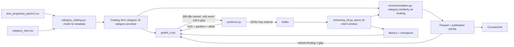

# Implementation plan: realtime intent + category similarity + UI

Cập nhật: 02/11/2026. Trạng thái: kế hoạch triển khai; chưa thay đổi mã chạy của hệ thống.

## 1. Kết quả cần đạt

1. Recommendation dựa trên intent tính từ sự kiện Kafka trong cửa sổ hiện tại và độ tương đồng danh mục sản phẩm. Bỏ Item-CF, lịch sử đồng tương tác và popularity fallback hiện tại.
2. Window **10 phút**, slide **5 phút**, watermark **2 phút**; trigger Spark mặc định **5 giây**.
3. UI Gradio hiển thị dòng tương tác người dùng. Khi bấm Bắt đầu, hệ thống phát một interaction mỗi **5 giây** và thêm dòng vào UI sau khi Kafka ACK thành công.
4. UI đồng thời hiển thị intent và recommendation thực sự do Spark công bố, cùng trạng thái đang chờ xử lý nếu Spark chưa theo kịp.
5. Giữ logging micro-batch, Parquet, ConsoleSink, checkpoint và cơ chế công bố kết quả theo batch hiện có.

Quyết định nghiệp vụ cập nhật theo A2: `view=1`, `addtocart=5`, `transaction=10`; kích hoạt khi `transactions = 0 AND intent_score >= 5`, **không bắt buộc có addtocart**. Policy chính là `extended`, bao gồm heavy browsing: **5 lượt view cùng item của cùng visitor trong cùng window → score 5 → kích hoạt recommendation**. Top-K mặc định bằng 3. `strict_cart` chỉ có thể giữ làm tùy chọn đối chiếu, không phải policy mặc định của pipeline/UI.

## 2. Dữ liệu và giới hạn cần hiểu đúng

Đã đối chiếu header của dữ liệu trong repo:

| File | Dữ liệu có trong file | Vai trò sau thay đổi |
|---|---|---|
| `retailrocket/category_tree.csv` | `categoryid,parentid` | Cây danh mục để tính quan hệ giữa hai category. |
| `retailrocket/item_properties_part1.csv` | `timestamp,itemid,property,value` | Lấy các dòng `property=categoryid` để ánh xạ item → category. |
| `retailrocket/item_properties_part2.csv` | Cùng schema với part1 | Đọc cùng part1; hai phần là nguồn metadata hợp nhất. |
| Kafka `retail-rocket-events` | Năm trường event hiện tại | Nguồn duy nhất để tính hành vi và intent online. |
| `retailrocket/events.csv` | Tương tác trong dataset | Có thể giữ cho chế độ replay CLI, không dùng build similarity, tính popularity hay hồ sơ người dùng. UI mặc định sinh kịch bản tương tác mới. |

**Chỉ riêng `category_tree.csv` không đủ để suy ra item similarity:** file không chứa `itemid`. Vì vậy cần bảng item-category từ item properties. Bước chuẩn bị này xử lý metadata, không huấn luyện từ lịch sử hành vi.

Chọn snapshot metadata cố định: lấy category có timestamp mới nhất của mỗi item sau khi hợp nhất hai file properties. Nếu một item có nhiều category khác nhau ở cùng timestamp mới nhất, loại item đó và ghi số lượng xung đột, không chọn tùy tiện. Snapshot này dùng cho demo với timestamp hiện tại; không tuyên bố hỗ trợ metadata theo thời điểm lịch sử của từng event.

## 3. Luồng xử lý dự kiến



UI chạy Python trên Windows, Kafka/Spark trong Docker Compose như kiến trúc hiện có. UI chỉ điều khiển producer và đọc output đã commit; toàn bộ intent/ranking nghiệp vụ nằm trong Spark.

## 4. Thuật toán recommendation sẽ code

### 4.1. Intent realtime

Giữ aggregation theo `(visitorid, itemid, window_start, window_end)`:

```python
events.withWatermark("event_time", "2 minutes").groupBy(
    F.window("event_time", "10 minutes", "5 minutes"),
    "visitorid", "itemid",
)
```

```text
intent_score = views + 5*carts + 10*transactions
eligible_seed = transactions == 0 AND intent_score >= 5
```

| Hành vi của cùng visitor/item trong cùng window | Score | Eligible seed | Lý do |
|---|---:|---|---|
| 4 views, chưa mua | 4 | Không | Chưa đạt ngưỡng. |
| 5 views, không cart, chưa mua | 5 | Có | `heavy_browsing`. |
| 6 views, không cart, chưa mua | 6 | Có | `heavy_browsing`; cập nhật điểm ranking. |
| 1 addtocart, chưa mua | 5 | Có | `cart_no_purchase`. |
| 1 view + 1 addtocart, chưa mua | 6 | Có | `cart_no_purchase`. |
| 5 views + 1 transaction | 15 | Không | `purchased`; transaction chặn seed dù score cao. |

Năm lượt view phải được Spark chấp nhận và cộng vào **cùng khóa `(visitorid, itemid, window_start, window_end)`**, không phải năm view chia cho nhiều item, visitor hoặc window rồi cộng gộp. Một event có thể thuộc hai window chồng lấn nhưng không được tính hai lần trong cùng một window.

Gán `recommendation_reason=cart_no_purchase` khi seed có cart; nếu seed đủ ngưỡng nhưng không có cart, gán `heavy_browsing`. Hai trường hợp đều có `status=recommend`. Transaction ưu tiên `status=purchased` và reason rỗng. Dùng cùng `eligible_expression()` trong tính intent và sinh candidate, tránh UI báo recommend nhưng ranking vẫn lọc bắt buộc cart.

Một seed là sản phẩm đủ điều kiện trong window của một visitor. Transaction vô hiệu seed của chính item đó trong window tương ứng; nếu visitor còn seed khác chưa mua, recommendation có thể vẫn tồn tại. Nếu không còn seed, công bố `recommendations=[]` để UI xóa kết quả cũ.

Đạt ngưỡng là đủ điều kiện kích hoạt bước sinh candidate; có top-K thực tế còn phụ thuộc metadata và ứng viên chưa được xem. Demo heavy browsing sẽ chọn item có category hợp lệ và đủ candidate để quan sát được danh sách gợi ý. Nếu thiếu metadata/candidate thì công bố lý do cùng danh sách rỗng, không gợi ý lại seed để lấp chỗ.

### 4.2. Similarity từ cây category

Xây đường đi tổ tiên cho từng category; root có depth 0. Với hai category `a,b`, dùng tổ tiên chung gần nhất `LCA(a,b)`:

```text
sim(a,b) = 1                                  nếu a == b
sim(a,b) = 0                                  nếu không có tổ tiên chung
sim(a,b) = 0                                  nếu chỉ chung root và a != b
sim(a,b) = 2*depth(LCA)/(depth(a)+depth(b))      trong các trường hợp còn lại
```

Ví dụ: A và B cùng category → 1; hai category anh em ở depth 2, chung parent depth 1 → 0,5; hai nhánh chỉ chung root → 0. Root giống chính nó dùng quy tắc cùng category nên không chia cho 0.

Với seed không có category hợp lệ, bỏ seed đó khỏi bước sinh ứng viên và công bố lý do. Không suy đoán category bằng item ID và không thay bằng sản phẩm phổ biến lịch sử.

### 4.3. Sinh ứng viên và xếp hạng

1. Lấy tất cả eligible seed và tập item visitor đã tương tác trong **cùng window**.
2. Tra category của seed; tìm category có similarity > 0, rồi join catalog để lấy candidate item.
3. Loại seed và toàn bộ item visitor đã tương tác trong window, bao gồm item đã mua.
4. Tính `rec_score(candidate) = SUM(intent_score(seed) * sim(seed_category, candidate_category))` trên các seed hợp lệ của visitor-window.
5. Gộp candidate trùng, sort `rec_score DESC, candidate_itemid ASC`, lấy top 3.
6. Đưa ra `source=category_tree`, category ứng viên và seed đóng góp để UI giải thích kết quả.
7. Không đủ ba ứng viên thì trả số lượng có thật; không có ứng viên thì trả `[]` với `generation_status=no_candidate`.

Không tạo bảng mọi cặp item toàn catalog. Tính quan hệ ở cấp category, chỉ mở rộng cho các visitor-window bị thay đổi. Để giảm số item trung gian mà vẫn giữ top-K đúng: sau khi loại seen-item, giữ tối đa K item có ID nhỏ nhất cho mỗi visitor-window/candidate-category; các item cùng category có cùng điểm nên các item còn lại không thể vượt lên theo quy tắc tie-break. Sau đó cộng đóng góp các seed và lấy top-K toàn window. Kiểm tra giả định một category/item đã được bảo đảm bởi bước chuẩn hóa metadata.

## 5. Danh sách file và nội dung sẽ code

### 5.1. Tạo `Part_B/category_catalog.py`

Module chuẩn bị và nạp metadata, chạy được qua `spark-submit`:

- `read_item_categories(spark, property_paths)`: đọc hai file properties với schema tường minh, lọc `property=categoryid`, chuẩn hóa số nguyên và lấy snapshot mới nhất như mục 2.
- `read_category_tree(tree_path)`: kiểm tra category trùng, parent thiếu, chu trình; hỗ trợ nhiều root. Dữ liệu cây không hợp lệ phải báo lỗi trước khi Spark streaming bắt đầu.
- `build_category_ancestors(tree)`: xuất `categoryid, ancestorid, depth, ancestor_depth, distance_to_ancestor`.
- `build_category_similarity(ancestors)`: tính `seed_categoryid, candidate_categoryid, category_similarity` theo công thức ở mục 4; lưu quan hệ có điểm > 0, gồm cùng category.
- `build_catalog(...)`: ghi `item_categories/`, `category_ancestors/`, `category_similarity/` dạng Parquet và `items_by_category.json` cho UI.
- `load_catalog(spark, catalog_path)`: nạp các bảng đã chuẩn bị, trả kèm manifest.
- CLI dự kiến: `--build --data-root /opt/data --output /opt/project/catalog/category-v1`.

Manifest lưu schema/algorithm version, hash các nguồn metadata, chính sách snapshot, số item hợp lệ, số item thiếu category/xung đột và catalog version. Chỉ rebuild khi nguồn metadata thay đổi; ghi vào thư mục tạm rồi công bố catalog hoàn chỉnh. Không đọc `events.csv` trong module này.

### 5.2. Sửa `Part_B/recommendation.py`

- Giữ `weight_expression()`; đổi mặc định `eligible_expression(policy="extended", threshold=5)` sang rule `transactions == 0 AND intent_score >= threshold`. Không thêm điều kiện `carts > 0` cho policy chính; nếu giữ `strict_cart`, chỉ dùng như tùy chọn đối chiếu.
- Thay `load_model()` bằng import `load_catalog()` từ `category_catalog.py`.
- Bỏ `build_model()`, các tham số `--history-end-ms`, `--sample-percent`, similarity từ co-occurrence và popularity fallback khỏi luồng chạy mới.
- Viết lại `generate_recommendations(context, item_categories, category_similarity, threshold, top_k, policy="extended")` theo mục 4; seed heavy browsing và seed có cart đều tham gia ranking bằng cùng công thức, không lọc cart lần thứ hai.
- Đổi `RECOMMENDATION_COLUMNS`: bỏ `popularity_score`; thêm `candidate_categoryid`, `category_similarity` lớn nhất trong các seed đóng góp và `contributing_seed_itemids`; giữ `rank`, `source`, `rec_score`.
- Giữ cast rõ ràng `rank=int`, item/category ID=`long`, điểm=`double`; xử lý DataFrame rỗng có schema đúng.
- Trả nguyên nhân riêng khi tất cả eligible seed thiếu category; không hiển thị như một recommendation thành công.

### 5.3. Sửa `Part_B/streaming_etl.py`

- Đổi mặc định `load_config()` thành window 10 phút, slide 5 phút, watermark 2 phút, trigger 5 giây.
- Đổi mặc định `RECOMMENDATION_POLICY` thành `extended`; dùng cùng policy trong `compute_intent()` và `generate_recommendations()`. `compute_intent()` giữ phân biệt reason `heavy_browsing` / `cart_no_purchase` như mục 4.1.
- Thay `MODEL_PATH` bằng `CATEGORY_CATALOG_PATH`; nạp catalog một lần khi startup.
- Sửa `main()`, `intent_writer()`, `write_batch()` để truyền catalog/category similarity thay vì similarity Item-CF/popularity.
- Cập nhật đồng bộ `RECOMMENDATION_SCHEMA`, `PUBLICATION_SCHEMA`, `_recommendation_updates()` và schema array recommendation khi bỏ popularity/thêm category.
- Bổ sung record `kind=intent_update` trong publication: batch ID, visitor, item, window, counts, intent score, `recommendation_active`, `recommendation_reason` và trạng thái. UI đọc các dòng này để hiển thị intent mà không phải đọc toàn bộ Parquet mỗi giây.
- Giữ record `kind=recommendation_update` thay thế toàn bộ top-K của visitor-window; giữ update rỗng để thu hồi kết quả.
- Bump publication `schema_version=2`; đổi metadata từ `model_version` sang `catalog_version` và ghi algorithm `category-tree-v1`. Sửa cả kiểm tra tái sử dụng commit trong `write_batch()`.
- `pipeline.json` phải lưu đủ catalog hash/version, schema version, algorithm, rule, weights, top-K, window/slide/watermark. Sai metadata thì từ chối dùng chung namespace.
- Giữ snapshot hợp nhất qua batch, partition Parquet theo `event_date`, checkpoint độc lập cho từng query và commit publication nguyên tử.
- Giữ lọc `kind=recommendation_update` trong `console_writer()` để intent update mới không làm hỏng ConsoleSink.
- Giữ `BatchMetrics`: batch ID, input records, trigger duration, watermark và state memory. Không cộng input count của các query độc lập thành số tương tác duy nhất.
- Phân biệt Spark state với snapshot lưu trữ: snapshot cũ có thể giữ để audit nhưng chỉ context cùng window được tham gia ranking. UI không được lấy window cũ làm kết quả hiện hành.

### 5.4. Sửa `Part_B/producer.py`

Hiện producer chủ yếu có CLI; các test cũ đang import một số hàm không còn tồn tại. Sẽ chuẩn hóa API dùng chung cho CLI/UI:

- `create_producer(bootstrap_servers)`.
- `build_live_event(visitorid, itemid, event, transactionid=None)`: tạo payload đúng năm trường, timestamp hiện tại ngay trước lúc gửi; transaction cần mã giao dịch hợp lệ.
- `send_event(producer, topic, event)`: dùng key visitorid, chờ Kafka ACK, trả `topic, partition, offset, acknowledged_at`.
- `iter_demo_interactions(catalog, demo_session_id)`: chọn item có category và có ứng viên, sinh kịch bản ổn định cho nhiều visitor, gồm một chuỗi năm view cùng item không có cart để chứng minh heavy browsing và một chuỗi có cart để đối chiếu; không lấy co-occurrence hay popularity từ events lịch sử.
- `run_live_demo(..., interval=5.0, stop_event, on_sent, on_error)`: worker có thể dừng; callback `on_sent` chỉ chạy sau ACK.
- Giữ `parse_event()`, `read_events()` và tùy chọn replay CSV CLI; bổ sung `replay_events()` dùng chung send API để sửa tương thích test hiện có.
- CLI demo mặc định dùng 5 giây; replay CSV giữ `--interval` điều chỉnh được. UI luôn dùng interval cố định 5 giây theo yêu cầu này.

Worker dùng đồng hồ `monotonic` và `stop_event.wait(timeout)` theo deadline, không gọi `sleep(5)` trong callback UI. Lần đầu phát sau 5 giây; các lần sau nhắm mốc 10, 15, 20 giây… Nếu Kafka chậm vượt deadline, bỏ các nhịp đã lỡ và chờ nhịp kế tiếp, không gửi bù một loạt. Không hứa đúng 5 giây tuyệt đối khi broker lỗi; UI phải báo lỗi/chờ ACK thay vì tự tạo interaction giả.

### 5.5. Tạo `Part_B/demo_runtime.py`

Tách vòng đời demo khỏi layout Gradio để có thể kiểm tra độc lập:

- Class `DemoRuntime` sở hữu một producer, một worker, stop event, lock và hàng đợi interaction giới hạn 200 dòng.
- `start()`, `stop()`, `status()`, `read_interactions()`: start khi đang chạy không tạo worker thứ hai; stop không sinh thêm send mới sau khi worker xác nhận đã dừng. Send đang chờ ACK có thể hoàn tất và vẫn phải được ghi nhận.
- Ghi các interaction đã ACK vào `output/category-realtime-v1/demo/interactions.jsonl`; lưu timestamp, visitor, item, category, action, partition, offset. File là nhật ký phát sự kiện của UI, không phải dữ liệu huấn luyện.
- `PublicationReader` chỉ đọc `published/batch_*.jsonl` hoàn chỉnh, kiểm tra schema/pipeline/catalog và cập nhật cache theo khóa window; bỏ qua temp file, không nạp lại toàn bộ lịch sử mỗi refresh.
- Cache intent theo visitor/item/window; recommendation theo visitor/window và thay danh sách bằng `[]` khi có clear.
- UI demo dùng chung một runtime trong một tiến trình phục vụ local; nhiều tab không tạo thêm producer worker. Restart UI bắt đầu ở trạng thái Dừng, có thể đọc lại tail nhật ký; không tự replay tương tác đã ACK.

### 5.6. Tạo `Part_B/gradio_ui.py`

Tại lúc lập kế hoạch file này **không tồn tại** trên ổ đĩa; sẽ tạo mới thay vì dựa vào tài liệu UI cũ.

Layout dự kiến:

```text
[Bắt đầu] [Dừng]  Trạng thái: Đang chạy / Đã dừng / Kafka lỗi
Nhịp phát: 5 giây | Đã gửi: N | Spark batch gần nhất | Độ trễ batch

TƯƠNG TÁC NGƯỜI DÙNG
Thời gian | Visitor | Item | Category | Hành động | Partition | Offset

[Chọn visitor]
INTENT TRONG WINDOW                     SẢN PHẨM GỢI Ý
Item | Views | Carts | Purchases         Rank | Item | Category | Score
Intent score | Trạng thái | Lý do        Seed đóng góp | Quan hệ danh mục

Window bắt đầu/kết thúc | Batch ID | Đang chờ Spark / Đã có kết quả
```

- Dùng Gradio Blocks và timer refresh khoảng 1 giây. Timer chỉ đọc cache/output; không phát interaction.
- Nút Bắt đầu gọi runtime.start(), nút Dừng gọi runtime.stop(); không chạy vòng lặp dài trong callback.
- Nhãn hành động tiếng Việt: Xem, Thêm giỏ hàng, Mua hàng; payload giữ `view/addtocart/transaction`.
- Hiển thị policy đang chạy `extended`, threshold 5, tiến độ view của item đang chọn và reason từ Spark. Highlight chuyển tiếp **4 views / score 4 / chưa đủ điều kiện → 5 views / score 5 / recommend / heavy_browsing**, kể cả khi carts bằng 0. Không tự kích hoạt chỉ vì bảng interaction phía UI đã có năm dòng; phải chờ intent/recommendation do Spark công bố.
- Diễn giải `heavy_browsing` là quan tâm qua nhiều lượt xem; `cart_no_purchase` là đã thêm giỏ nhưng chưa quan sát thấy transaction trong window. Không gọi hai trạng thái này là đã bỏ giỏ hàng.
- Interaction thêm vào bảng dựa trên ACK thật. Ghi rõ đây là các tương tác do demo UI phát, không tuyên bố là toàn bộ topic nếu có producer ngoài.
- Hiển thị thời gian theo `Asia/Ho_Chi_Minh`; event và publication dùng epoch ms/UTC trong lưu trữ.
- Một event thường thuộc hai window. Màn hình mặc định chọn window đang chứa thời gian hiện tại có `window_start` lớn nhất cho visitor; có selector xem từng window. Không cộng intent của hai window và không nối hai danh sách top-K.
- Window chưa có output thì hiển thị Đang chờ Spark. Output từ window đã hết thời gian chỉ nằm trong lịch sử, không giữ ở bảng recommendation hiện tại.
- Spark có thể xử lý lâu hơn 5 giây; UI vẫn phân biệt interaction đã gửi với intent đã xử lý, không tính intent/ranking thay Spark.
- Lắng nghe shutdown để dừng worker và đóng producer. Chạy local `127.0.0.1:7860`, `share=False`.

### 5.7. Sửa `Part_B/docker-compose.yml`

Thay service `model-builder` bằng `catalog-init`, chạy bước chuẩn bị metadata. Spark phụ thuộc cả `kafka-init` và `catalog-init` hoàn tất thành công. Catalog-init tái sử dụng catalog có manifest phù hợp để không đọc lại gần 900 MB item properties mỗi startup.

```yaml
PIPELINE_ID: category-realtime-v1
RECOMMENDATION_POLICY: extended
INTENT_THRESHOLD: "5"
RECOMMENDATION_TOP_K: "3"
STREAM_WINDOW: "10 minutes"
STREAM_SLIDE: "5 minutes"
STREAM_WATERMARK: "2 minutes"
STREAM_TRIGGER: "5 seconds"
CATEGORY_CATALOG_PATH: /opt/project/catalog/category-v1
STREAM_OUTPUT: /opt/project/output/category-realtime-v1
STREAM_CHECKPOINT_ROOT: /opt/project/checkpoints/category-realtime-v1
```

Bỏ `MODEL_PATH`, `MODEL_HISTORY_END_MS`, `MODEL_SAMPLE_PERCENT` khỏi cấu hình mới. Giữ volume metadata `/opt/data:ro` và Kafka topic hai partition. UI chạy trên host nên dùng đường dẫn `Part_B/catalog/category-v1` và `Part_B/output/category-realtime-v1` tương ứng, không dùng đường dẫn `/opt/project` của container.

Namespace mới giúp đổi watermark và schema an toàn; không xóa checkpoint/output/model cũ. Trong smoke test dùng topic tách biệt; demo live dùng timestamp hiện tại và visitor mới để tránh trộn với event lịch sử còn trong topic.

### 5.8. Sửa dependency và tài liệu

| File | Nội dung sẽ sửa |
|---|---|
| `Part_B/requirements.txt` | Thêm Gradio, pin phiên bản đã xác minh chạy được; giữ kafka-python. Module UI không import PySpark; chuẩn bị catalog/ranking chạy trong Spark container. |
| `.gitignore` | Thêm catalog sinh ra, output/checkpoint namespace mới nếu quy tắc hiện tại chưa bao phủ; vẫn theo dõi fixture và manifest mẫu nhỏ. |
| `Part_B/README.md` | Cách khởi động catalog-init/Kafka/Spark, chạy UI, dùng Start/Stop và đọc kết quả. Bỏ bước bắt buộc build Item-CF; nêu policy mặc định extended, năm view cùng item đủ trigger và transaction chặn seed. |
| `README.md`, `REPORT.md` | Đồng bộ hướng dẫn và mô tả policy với A2/Part B: heavy browsing là hành vi chính thức của bản mới; cập nhật candidate top-K và output/checkpoint để không còn mô tả thuật toán cũ như code hiện hành. |
| `REPORT_pt_2.md` | Mô tả category similarity, công thức ranking, nguồn metadata, cấu hình 10/5/2 và rule extended; bỏ kết luận năm view không trigger trong policy mặc định. |
| `LAM_MIN_YEU_CAU_DE_TAI.md` | Đồng bộ thông số và rule extended theo yêu cầu người dùng mới; thay gap analysis lỗi thời. Phân biệt rõ bản thiết kế mới với đề gốc: đề Word quy định watermark 5 phút và nêu tình huống addtocart chưa transaction; bản này dùng watermark 2 phút và mở rộng trigger sang heavy browsing theo A2, không ghi các thay đổi thành trích dẫn của đề. |
| `Part_A/A2_Recommender_Systems/A2_Recommender_Systems_Spark_Streaming_v3_vi.ipynb` | Giữ rule minh họa `score >= 5 AND transactions = 0`; chỉ đồng bộ mô tả liên kết nếu cần để xác nhận Part B cũng hỗ trợ 5 views trigger. Không đổi A2 về strict cart. |
| `ARCHITECTURE.md` | Thay luồng build model lịch sử bằng chuẩn bị catalog và thêm worker UI 5 giây. |
| `Part_B/docs/IMPLEMENTATION_PLAN_RECOMMENDATION_TRIGGER_SINK.md` và `Part_B/docs/IMPLEMENTATION_PLAN_DESKTOP_UI.md` | Thêm ghi chú được kế hoạch này thay thế ở phần recommendation/cấu hình/UI; giữ nội dung cũ để truy vết. |

Các cập nhật này thuộc giai đoạn triển khai sau; bản kế hoạch hiện tại không sửa các tài liệu còn lại.

## 6. Kịch bản demo định trước

Chọn item A và B có category hợp lệ và ít nhất ba item liên quan chưa được visitor tương ứng xem. Tạo hai visitor mới mỗi lần Bắt đầu; U1 minh họa heavy browsing, U2 minh họa cart. Các mốc cho mỗi visitor/item phải cùng thuộc window được dùng để đối chiếu (tránh chạy đoạn đó sát ranh giới bắt đầu window 5 phút hoặc chọn window chồng lấn chứa đủ chuỗi):

| Mốc dự kiến sau Bắt đầu | Visitor | Interaction | Kỳ vọng sau khi Spark xử lý |
|---|---|---|---|
| 5 giây | U1 | view A lần 1 | Views = 1, carts = 0, score = 1; chưa gợi ý. |
| 10 giây | U1 | view A lần 2 | Views = 2, score = 2; chưa gợi ý. |
| 15 giây | U1 | view A lần 3 | Views = 3, score = 3; chưa gợi ý. |
| 20 giây | U1 | view A lần 4 | Views = 4, score = 4; chưa gợi ý. |
| 25 giây | U1 | view A lần 5 | Views = 5, carts = 0, score = 5; `recommend`, reason `heavy_browsing`, hiện top-K theo category của A. |
| 30 giây | U1 | transaction A | Score A = 15; `purchased`, U1 hết seed nên phát clear `[]`. |
| 35 giây | U2 | view B | Score B = 1; chưa gợi ý. |
| 40 giây | U2 | addtocart B | Score B = 6; `recommend`, reason `cart_no_purchase`, U2 nhận top-K riêng. |
| 45 giây | U2 | transaction B | Score B = 16; `purchased`, U2 hết seed nên phát clear `[]`. |
| 50 giây trở đi | U3/U4… | Lặp hai nhánh bằng visitor mới | Tiếp tục thêm đúng một event mỗi nhịp 5 giây đến khi Dừng. |

Chọn item seed từ catalog, không chọn chính candidate của cùng visitor làm seed ở bước sau nếu làm mờ tình huống cần demo. Kịch bản có thể lặp bằng visitor mới, không reset state Spark mỗi vòng. Nếu không có category nào đủ ba ứng viên thì vẫn chạy với số thực tế và thông báo thiếu ứng viên.

Các mốc trên là lịch phát dự kiến; thời điểm recommendation xuất hiện còn phụ thuộc micro-batch. Slide 5 phút là độ dịch cửa sổ event-time, không phải phải chờ 5 phút mới có recommendation. Watermark 2 phút tiến theo event-time đã quan sát; khi không có event mới, không tuyên bố Spark tự hết hạn state theo đồng hồ UI.

Để minh họa chắc chắn chuyển tiếp 4 → 5 views và recommendation trước transaction khi Spark chậm, bổ sung chế độ **Từng bước**: gửi một event, chờ commit intent/recommendation tương ứng rồi mới cho phép gửi bước tiếp theo. Chế độ Tự động vẫn phát mỗi 5 giây; chế độ Từng bước không cam kết nhịp này. `producer.py` cung cấp iterator chung, `demo_runtime.py` quản lý vị trí kịch bản và trạng thái chờ commit, `gradio_ui.py` cung cấp chọn chế độ/nút Bước tiếp theo. Hai chế độ dùng chung một luồng phát và không chạy đồng thời; chỉ đổi chế độ khi worker đã dừng.

## 7. Kiểm thử sẽ code và tiêu chí nghiệm thu

| File | Kiểm tra hành vi |
|---|---|
| Tạo `tests/test_category_catalog.py` | Fixture cây có nhiều root; cùng category, anh em, ancestor/descendant và chỉ chung root; cycle/parent lỗi; hợp nhất properties và category mới nhất; xử lý timestamp xung đột. |
| Tạo `tests/test_category_recommendation.py` | Spark fixture: 4 views không trigger; 5/6 views không cart vẫn trigger; một cart trigger; transaction chặn seed dù score cao; không cộng views từ các item/visitor/window khác nhau để vượt ngưỡng; score là tổng intent × similarity; deterministic tie-break; nhiều seed; loại seen/purchased; category thiếu; không có fallback popularity; đủ/thiếu top-K; tối ưu theo category vẫn cho top-K giống phép tính đầy đủ trên fixture nhỏ. |
| Sửa `tests/test_producer.py` | API mới khớp code; payload năm trường; key visitor; ACK trước callback; lỗi gửi không thêm dòng thành công; stop chặn send kế tiếp; giữ replay CLI; iterator phát đúng năm view cùng U1/A trước transaction và có nhánh cart của U2/B. |
| Tạo `tests/test_demo_runtime.py` | Đồng hồ/scheduler giả: nhịp 5/10/15 giây; không burst sau chậm; Start nhiều lần chỉ một worker; Stop/Start; cache bounded; publication clear và tránh đọc trùng; schema sai không trộn dữ liệu; chế độ Từng bước không gửi tiếp khi chưa có commit, không chạy song song với worker tự động. |
| Sửa `tests/verify_part_b.py` | Thay fixture Item-CF/popularity bằng metadata category; policy mặc định extended; kiểm tra heavy browsing 5 views và cart trigger, ranking, publication schema v2 có reason, transaction clear, replay batch idempotent, Parquet và ConsoleSink. |
| Sửa `tests/test_ui.py` và `tests/verify_ui.py` | Bỏ import/API UI cũ không còn tồn tại; xác minh Start/Stop, interaction đã ACK, pending Spark, hiển thị 4 → 5 views và reason heavy_browsing với carts = 0, top-K đúng, transaction clear, chọn window, chế độ Từng bước và hai tab không tăng tốc producer. |
| Tạo `tests/verify_category_streaming.py` | End-to-end Kafka → Spark với topic/output/checkpoint riêng: schema, cửa sổ 10/5, watermark 2, bốn view đã commit chưa recommend rồi view thứ năm ở batch sau kích hoạt top-K khi carts = 0; out-of-order, state eviction; restart cùng visitor/item/window với score 4 rồi gửi view thứ năm để chứng minh state phục hồi thành score 5 và recommend; transaction sau đó thành score 15 và clear nếu không còn seed khác. |
| Sửa `tests/collect_proof.py` | Thu bằng chứng mới cùng hash code/catalog, config runtime, metrics, output, kết quả test và ảnh UI; không ghi đè bộ proof cũ dưới danh nghĩa cùng phiên bản. |
| Tạo `tests/fixtures/category_realtime/` | CSV nhỏ gồm category tree, hai part properties và event kịch bản. Dữ liệu cố định để tính tay expected ranking. |

Kiểm tra late-event dựa vào tiến độ watermark và thời điểm kết thúc từng window: một event có thể bị loại khỏi window cũ nhưng còn được cập nhật trong window chồng lấn khác. Không dùng quy tắc đơn giản “timestamp cũ hơn max event-time 2 phút thì mọi output đều phải biến mất”. Test sẽ đẩy event-time đủ xa, chờ batch cập nhật watermark rồi gửi late event để xác minh rõ trường hợp bị loại hoàn toàn.

Nghiệm thu UI trên môi trường ổn định: quan sát ít nhất sáu interaction đã ACK trong khoảng 30 giây cộng sai số scheduler/ACK, các mốc cách nhau xấp xỉ 5 giây; không có dòng giả khi broker lỗi. Phải chứng minh cả hai nhánh: **4 views → chưa recommend; view thứ năm → score 5, carts = 0, reason heavy_browsing và top-K; transaction → score 15, clear**; và `view → addtocart → transaction` với score **1 → 6 → 16**. Dùng chế độ Từng bước nếu các hành vi bị gộp cùng batch khi tự động. Sau Dừng và worker kết thúc, số send không tiếp tục tăng.

Không đặt SLA “recommendation chính xác sau 5 giây”: ghi lại độ trễ thực tế và trạng thái pending nếu Spark chưa xử lý xong. Trigger 5 giây không bảo đảm batch hoàn tất trong 5 giây.

## 8. Thứ tự triển khai và đầu ra từng bước

1. **Catalog:** code `category_catalog.py`, fixture và test cây/item mapping. Đầu ra: metadata versioned có thể nạp, chưa cần Kafka.
2. **Ranking:** sửa `recommendation.py`, schema và test công thức. Đầu ra: top-K category đúng trên fixture, nhận cả seed heavy browsing và seed có cart theo rule extended, không phụ thuộc lịch sử interaction.
3. **Streaming:** sửa `streaming_etl.py`, Compose và publication v2. Đầu ra: Kafka → intent → category recommendation → Parquet/console, config 10/5/2, policy mặc định extended thống nhất với A2.
4. **Producer/runtime:** chuẩn hóa producer API và code `demo_runtime.py`. Đầu ra: một worker phát 5 giây có Start/Stop và ACK log.
5. **UI:** tạo `gradio_ui.py`, thêm dependency, nối interaction/intent/recommendation/metrics. Đầu ra: màn hình local hoạt động theo kịch bản.
6. **Nghiệm thu:** chạy unit/fixture test, end-to-end, restart và UI checks; cập nhật tài liệu, lưu proof mới theo namespace riêng.

Đợt này không thêm huấn luyện online, ALS, hồ sơ sở thích dài hạn, popularity lịch sử, tên/ảnh sản phẩm hay deploy public. UI hiển thị item/category ID thật vì dataset không cung cấp sẵn tên/ảnh trong các nguồn được chọn.
