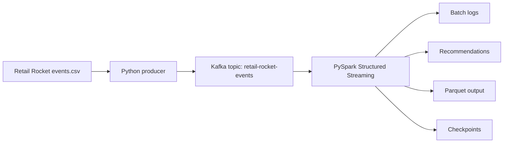

# Retail Rocket Real-Time Streaming

Project for the Kafka and PySpark Structured Streaming assignment.

## Architecture



The source dataset is currently at `retailrocket/events.csv` within this project directory. Compose mounts it read-only at `/opt/data/events.csv` inside Spark. The producer will replay its rows as Kafka messages. Spark will parse those messages, calculate intent in sliding windows, and write logs and recommendations.

## Planned environment

| Component | Version/image | Purpose |
| --- | --- | --- |
| Python on the development machine | 3.13.9 observed | Run the producer and local checks |
| Kafka | `apache/kafka:4.3.1` | Single-node KRaft broker for the classroom demo |
| Spark | `apache/spark:4.2.0-python3` | Run the PySpark streaming application |
| Spark Kafka connector | `org.apache.spark:spark-sql-kafka-0-10_2.13:4.2.0` | Let Spark read Kafka messages |

The Kafka and Spark images are proposed for the Compose setup; confirm they start together during the Kafka setup stage. Keep Spark and its Kafka connector at the same version.

## Stage 0 environment checks

Open Docker Desktop and wait until its engine is running. From this project directory, run:

```powershell
python --version
git --version
docker --version
docker compose version
docker info
git status --short
```

`docker info` should show server information. Running `git status` from this directory checks the submission repository, which is separate from its parent course repository.

## Separate Docker Compose project

This repository has its own Compose project named `retail_rocket_streaming`. It starts a Kafka broker and a Spark container without changing the `multimodal_ocr` project. Kafka is available to host Python code at `localhost:9092` and to Spark inside Docker at `kafka:19092`.

From this project directory:

```powershell
docker compose config
docker compose up -d
docker compose ps
```

The first startup downloads the pinned images. Docker Desktop should then show `retail_rocket_streaming` as a separate group. The Spark container remains idle until a streaming application is submitted in a later stage.

To stop this project's containers, run `docker compose stop` from this directory. To start them again, run `docker compose start`. Do not run these commands from another project's directory.

## Python environment for the producer

Create a project-specific virtual environment in this directory and install the host-side dependency:

```powershell
python -m venv .venv
.\.venv\Scripts\python.exe -m pip install -r requirements.txt
.\.venv\Scripts\python.exe -m pip show kafka-python
```

Using `.venv\Scripts\python.exe` directly avoids changing PowerShell's script execution policy. The `.venv/` directory is ignored by Git. `requirements.txt` contains only the Python Kafka client needed by the producer; standard-library modules such as `csv`, `json`, `argparse`, `logging`, and `time` need no installation. PySpark will run in the Spark Docker image, and its Kafka connector is supplied as a Spark package rather than a pip requirement.
