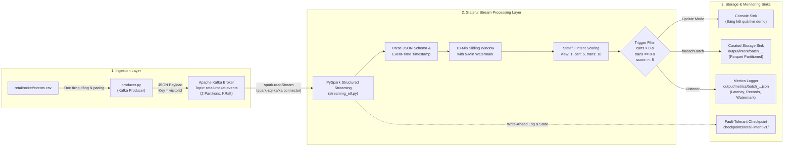
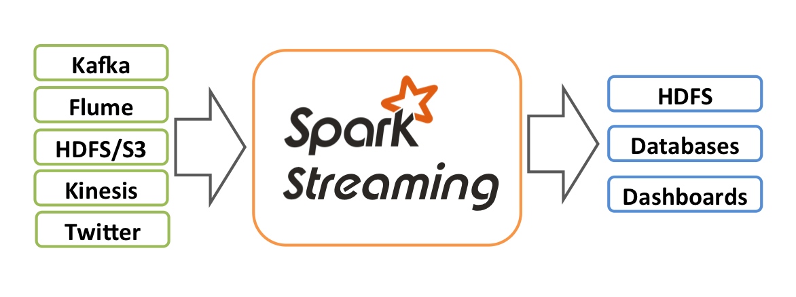
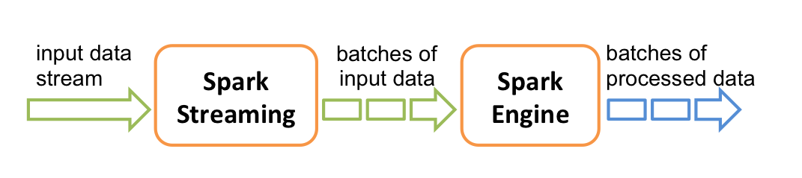
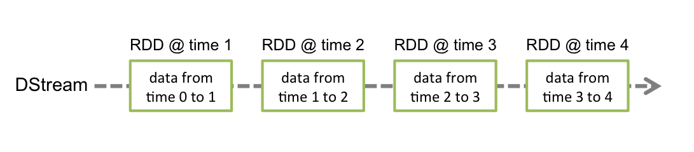
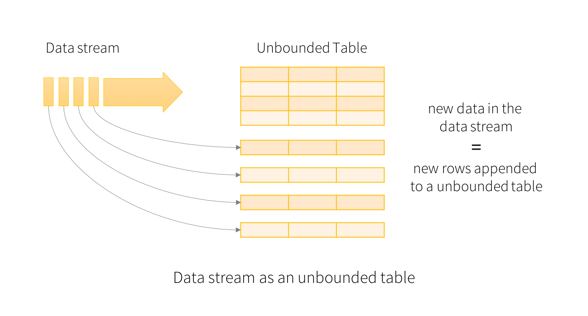
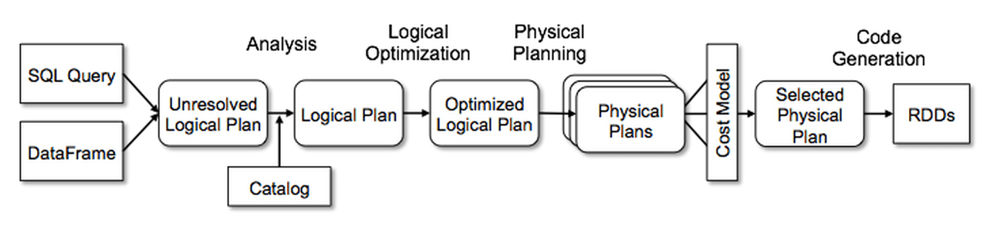
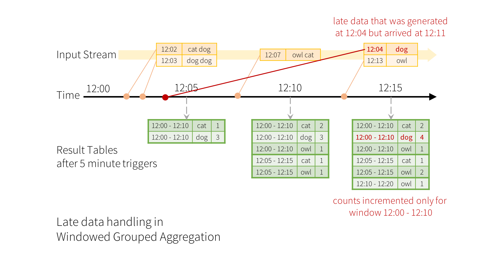
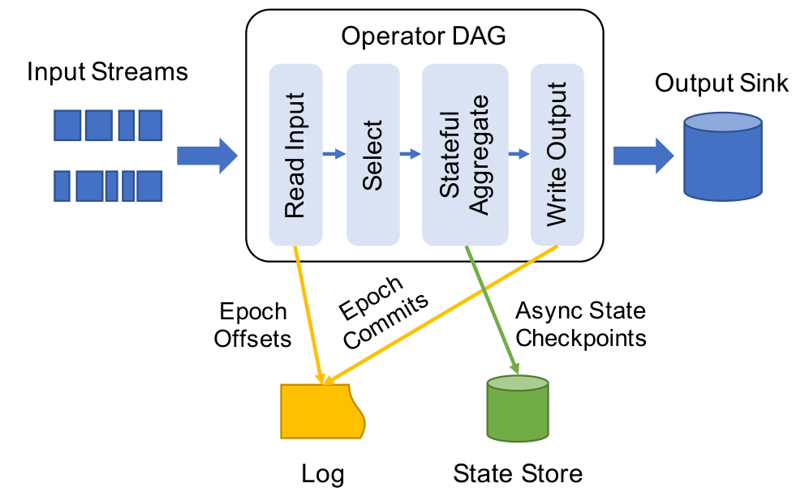

# BÁO CÁO KỸ THUẬT TỔNG THỂ DỰ ÁN CUỐI KỲ
## ĐỀ TÀI: REAL-TIME STREAMING WITH KAFKA & PYSPARK STRUCTURED STREAMING
### HỆ THỐNG THEO DÕI Ý ĐỊNH MUA HÀNG VÀ GỢI Ý SẢN PHẨM THỜI GIAN THỰC (RETAIL ROCKET DATASET)

---

> **Môn học:** Dữ liệu lớn (Big Data)  
> **Bộ dữ liệu thực nghiệm:** Retail Rocket E-Commerce Events Dataset (Kaggle)  
> **Nhóm thực hiện:** Nhóm 5 
> **Giảng viên hướng dẫn:** Bộ môn Dữ liệu lớn   

---

## THÀNH VIÊN NHÓM 5

| STT | Họ và tên | Mã sinh viên |
| :---: | :--- | :---: |
| 1 | **Nguyễn Phú Nam** | 11230574 |
| 2 | **Hồ Đức Mạnh** | 11230565 |
| 3 | **Nguyễn Phương Đông** | 11230530 |
| 4 | **Vũ Tuấn Đạt** | 11230529 |
| 5 | **Nguyễn Đại Quân** | 11230586 |
| 6 | **Trần Minh Đức** | 11230531 |
| 7 | **Nguyễn Tuấn Phong** | 11230580 |

---

# MỤC LỤC BÁO CÁO

* [CHƯƠNG 1: TỔNG QUAN HỆ THỐNG & ĐẶC TẢ BÀI TOÁN](#chương-1-tổng-quan-hệ-thống--đặc-tả-bài-toán)
  * [1.1. Bối cảnh & Mục tiêu đề tài](#11-bối-cảnh--mục-tiêu-đề-tài)
  * [1.2. Đặc tả tập dữ liệu Retail Rocket](#12-đặc-tả-tập-dữ-liệu-retail-rocket)
  * [1.3. Kiến trúc đường ống dữ liệu End-to-End Pipeline](#13-kiến-trúc-đường-ống-dữ-liệu-end-to-end-pipeline)
* [CHƯƠNG 2: PHẦN A - NỀN TẢNG LÝ THUYẾT & NGHIÊN CỨU HỌC THUẬT (30 ĐIỂM)](#chương-2-phần-a---nền-tảng-lý-thuyết--nghiên-cứu-học-thuật-30-điểm)
  * [2.1. Kiến trúc Spark Streaming (Architecture of Spark Streaming)](#21-kiến-trúc-spark-streaming-architecture-of-spark-streaming)
    * [2.1.1. So sánh DStream vs. Structured Streaming](#211-so-sánh-dstream-vs-structured-streaming)
    * [2.1.2. Kiến trúc ETL trong xử lý luồng liên tục](#212-kiến-trúc-etl-trong-xử-lý-luồng-liên-tục)
    * [2.1.3. Tóm tắt bài báo khoa học về tối ưu ETL Streaming (ACM SIGMOD 2018)](#213-tóm-tắt-bài-báo-khoa-học-về-tối-ưu-etl-streaming-acm-sigmod-2018)
  * [2.2. Hệ thống gợi ý thời gian thực với Spark Streaming (Recommender Systems)](#22-hệ-thống-gợi-ý-thời-gian-thực-với-spark-streaming-recommender-systems)
    * [2.2.1. So sánh cơ chế gợi ý Batch vs. Streaming và "Intent Half-Life"](#221-so-sánh-cơ-chế-gợi-ý-batch-vs-streaming-và-intent-half-life)
    * [2.2.2. Mô hình tính điểm ý định mua hàng (Live Intent Scoring)](#222-mô-hình-tính-điểm-ý-định-mua-hàng-live-intent-scoring)
    * [2.2.3. Điều kiện kích hoạt gợi ý sản phẩm tức thì (Recommendation Trigger)](#223-điều-kiện-kích-hoạt-gợi-ý-sản-phẩm-tức-thì-recommendation-trigger)
  * [2.3. Thu nhận dữ liệu phân tán thời gian thực: Kafka vs. Flume](#23-thu-nhận-dữ-liệu-phân-tán-thời-gian-thực-kafka-vs-flume)
    * [2.3.1. Phân tích chuyên sâu kiến trúc Apache Kafka & Chuyển dịch KRaft](#231-phân-tích-chuyên-sâu-kiến-trúc-apache-kafka--chuyển-dịch-kraft)
    * [2.3.2. Cơ chế tích hợp Spark qua connector `spark-sql-kafka-0-10`](#232-cơ-chế-tích-hợp-spark-qua-connector-spark-sql-kafka-0-10)
    * [2.3.3. Ma trận so sánh toàn diện: Apache Kafka vs. Apache Flume](#233-ma-trận-so-sánh-toàn-diện-apache-kafka-vs-apache-flume)
* [CHƯƠNG 3: PHẦN B - HIỆN THỰC KỸ THUẬT & VẬN HÀNH PIPELINE (70 ĐIỂM)](#chương-3-phần-b---hiện-thực-kỹ-thuật--vận-hành-pipeline-70-điểm)
  * [3.1. Hạ tầng cụm Docker Compose (Kafka KRaft & Spark Runtime)](#31-hạ-tầng-cụm-docker-compose-kafka-kraft--spark-runtime)
  * [3.2. Bộ phát sinh sự kiện Kafka (`producer.py`)](#32-bộ-phát-sinh-sự-kiện-kafka-producerpy)
  * [3.3. Đường ống xử lý PySpark Structured Streaming (`streaming_etl.py`)](#33-đường-ống-xử-lý-pyspark-structured-streaming-streaming_etlpy)
  * [3.4. Hệ thống giám sát vi mô (Micro-batch Logging) & Lưu trữ chịu lỗi (Sink & Checkpointing)](#34-hệ-thống-giám-sát-vi-mô-micro-batch-logging--lưu-trữ-chịu-lỗi-sink--checkpointing)
* [CHƯƠNG 4: HƯỚNG DẪN CÀI ĐẶT & KỊCH BẢN LIVE DEMO TRÊN LỚP (10–15 PHÚT)](#chương-4-hướng-dẫn-cài-đặt--kịch-bản-live-demo-trên-lớp-1015-phút)
  * [4.1. Quy trình cài đặt môi trường từ đầu (Setup Manual)](#41-quy-trình-cài-đặt-môi-trường-từ-đầu-setup-manual)
  * [4.2. Kịch bản trình diễn Live Demo (10–15 phút)](#42-kịch-bản-trình-diễn-live-demo-1015-phút)
* [CHƯƠNG 5: TÀI LIỆU THAM KHẢO (REFERENCES)](#chương-5-tài-liệu-tham-khảo-references)

---

# CHƯƠNG 1: TỔNG QUAN HỆ THỐNG & ĐẶC TẢ BÀI TOÁN

## 1.1. Bối cảnh & Mục tiêu đề tài
Báo cáo trình bày thiết kế và hiện thực hệ thống xử lý luồng sự kiện thời gian thực (Real-Time Data Streaming Pipeline) cho tập dữ liệu thương mại điện tử Retail Rocket bằng Apache Kafka và PySpark Structured Streaming.

Hệ thống giải quyết bài toán: Theo dõi hành vi người dùng trong phiên duyệt web, tính điểm ý định mua sắm (Intent Score) và kích hoạt gợi ý sản phẩm tức thì khi phát hiện khách hàng đã thêm sản phẩm vào giỏ nhưng chưa thanh toán.

Mục tiêu cụ thể:
1. **Thu nhận dữ liệu (Ingestion):** Sử dụng `producer.py` đọc tệp `events.csv` và phát luồng sự kiện JSON vào topic `retail-rocket-events` trên Apache Kafka (cụm 2 partitions, chạy KRaft mode).
2. **Xử lý luồng có trạng thái (Stateful Stream Processing):** PySpark Structured Streaming (`streaming_etl.py`) đọc luồng từ Kafka, kiểm tra cấu trúc schema, áp dụng Watermark 5 phút và Sliding Window 10 phút để tính điểm Intent Score (`view = 1`, `addtocart = 5`, `transaction = 10`).
3. **Kích hoạt gợi ý sản phẩm (Recommendation Trigger):** Lọc các khách hàng có $\text{carts} > 0$, $\text{transactions} = 0$ và $\text{Intent Score} \ge 5$ để xuất gợi ý sản phẩm trước khi phiên kết thúc.
4. **Lưu trữ & Chịu lỗi (Sink & Fault Tolerance):** Hiển thị kết quả ra Console, ghi dữ liệu tinh chế ra tệp Parquet và kích hoạt Checkpointing để tự động phục hồi trạng thái khi gặp sự cố.

---

## 1.2. Đặc tả tập dữ liệu Retail Rocket
Dự án sử dụng tệp `events.csv` trích xuất từ **Retail Rocket E-Commerce Dataset** trên Kaggle, gồm **2.75 triệu sự kiện** tương tác thực tế *(Xem chi tiết tại [DATA_DICTIONARY_AND_EDA.md](DATA_DICTIONARY_AND_EDA.md))*:

| Tên trường | Kiểu dữ liệu | Ý nghĩa nghiệp vụ | Ví dụ minh họa |
| :--- | :--- | :--- | :--- |
| `timestamp` | UNIX Epoch (ms) | Thời điểm chính xác sự kiện phát sinh tính bằng mili-giây | `1433221332117` |
| `visitorid` | Long / Integer | Định danh duy nhất của khách truy cập website | `257597` |
| `event` | String | Loại hành vi: `view` (xem), `addtocart` (thêm giỏ), `transaction` (thanh toán) | `"addtocart"` |
| `itemid` | Long / Integer | Định danh duy nhất của mặt hàng được tương tác | `355908` |
| `transactionid` | Long / Integer / Null | Mã giao dịch mua hàng (chỉ có giá trị khi `event = transaction`, còn lại `null`) | `null` hoặc `2854` |

---

## 1.3. Kiến trúc đường ống dữ liệu End-to-End Pipeline



---

# CHƯƠNG 2: PHẦN A - NỀN TẢNG LÝ THUYẾT & NGHIÊN CỨU HỌC THUẬT (30 ĐIỂM)

## 2.1. Kiến trúc Spark Streaming (Architecture of Spark Streaming)

### 2.1.1. So sánh DStream vs. Structured Streaming

Spark Streaming đã trải qua hai thế hệ kiến trúc lớn: **DStreams** (Discretized Streams - giới thiệu từ Spark 0.7) và **Structured Streaming** (giới thiệu từ Spark 2.0).


*Hình 2.1: Kiến trúc tổng quan tiếp nhận luồng sự kiện từ nguồn tới đích của Apache Spark.*

#### a. Mô hình xử lý: RDD Micro-batching vs. Unbounded Table
* **DStreams (Legacy):** Xử lý luồng bằng cách chia nhỏ dòng dữ liệu thành các mẩu vi mô (micro-batches) theo các khoảng thời gian cố định $T$ (batch interval, ví dụ 1 giây). Mỗi mẩu vi mô tương ứng với một tập dữ liệu phân tán bất biến **RDD (Resilient Distributed Dataset)**.
  
  
  *Hình 2.2: DStream chia dòng dữ liệu liên tục thành chuỗi các RDD micro-batch tuần tự.*

  DStream bản chất là một chuỗi liên tục các RDD:
  
  
  *Hình 2.3: Chuỗi các RDD biến đổi tuần tự qua từng batch interval.*

* **Structured Streaming (Modern):** Trừu tượng hóa dòng dữ liệu như một **Bảng dữ liệu vô hạn liên tục mở rộng (Unbounded Table)**. Mỗi bản ghi dữ liệu mới đến từ stream sẽ được xem như một dòng mới (row) được append vào bảng đầu vào. Nhà phát triển viết các câu truy vấn xử lý trên luồng tương tự như khi xử lý trên bảng tĩnh (DataFrame/Dataset API).

  
  *Hình 2.4: Mô hình dòng dữ liệu dưới dạng Bảng vô hạn liên tục nhận bản ghi mới.*

#### b. Động cơ thực thi: RDD thô vs. Catalyst Optimizer & Tungsten
* **DStreams:** Lập trình viên phải thao tác thủ công qua các hàm cấp thấp như `map`, `flatMap`, `reduceByKey`. Spark không hiểu được cấu trúc dữ liệu bên trong các đối tượng Java/Python, do đó không thể tự động tối ưu hóa kế hoạch thực thi.
* **Structured Streaming:** Tận dụng bộ tối ưu hóa truy vấn **Catalyst Optimizer** và công cụ quản lý bộ nhớ ngoài Heap **Tungsten**:
  * Tự động chiếu (projection pruning) và đẩy các bộ lọc xuống nguồn (predicate pushdown).
  * Chuyển đổi mã bytecode trực tiếp (Whole-Stage Code Generation), loại bỏ chi phí chuyển đổi dữ liệu và bộ gom rác JVM GC.

  
  *Hình 2.5: Quy trình tối ưu hóa truy vấn tự động qua bộ Catalyst Optimizer.*

#### c. Xử lý thời gian: Processing-Time vs. Event-Time & Watermarking
* **DStreams:** Mặc định phụ thuộc vào **Processing-Time** (thời điểm máy chủ nhận được dữ liệu). Do đó, nếu dữ liệu đến trễ do nghẽn mạng, sự kiện sẽ bị rơi vào sai batch interval, làm sai lệch báo cáo tài chính và số liệu thực.
* **Structured Streaming:** Hỗ trợ nguyên bản **Event-Time** (thời gian ghi nhận trong chính payload của sự kiện). Đi kèm với cơ chế **Watermarking**, cho phép hệ thống định nghĩa độ trễ tối đa chấp nhận được của dữ liệu ($T_{\text{watermark}} = \max(\text{event\_time}) - \text{delay\_threshold}$). Các bản ghi đến trễ nhưng vẫn nằm trong ngưỡng watermark sẽ được cập nhật chính xác vào cửa sổ kết quả tương ứng.

  
  *Hình 2.6: Cơ chế Watermark cập nhật lại kết quả cửa sổ khi có sự kiện đến trễ và dọn dẹp trạng thái cũ.*

#### d. Bảng ma trận so sánh toàn diện: DStreams vs. Structured Streaming

| Tiêu chí so sánh | Legacy DStreams (Spark Streaming cũ) | Modern Structured Streaming (Spark 2.x - 3.x) |
| :--- | :--- | :--- |
| **Mô hình cốt lõi** | Chuỗi các RDD vi mô (`DStream[T]`) | Mô hình bảng vô hạn (`Streaming DataFrame / Dataset`) |
| **Giao diện lập trình** | RDD Functional API (`map`, `filter`, `reduceByKey`) | Declarative SQL / DataFrame API (`select`, `groupBy`, SQL) |
| **Hỗ trợ Event-Time** | Rất hạn chế, chủ yếu xử lý theo Processing-Time | Hỗ trợ nguyên bản dựa trên cột thời gian trong dữ liệu |
| **Xử lý dữ liệu trễ** | Không có cơ chế chuẩn, lập trình viên tự quản lý | Có cơ chế **Watermarking** tự động dọn dẹp state |
| **Bộ tối ưu hóa** | Không có bộ tối ưu truy vấn cấp cao | Tận dụng toàn bộ sức mạnh của **Catalyst & Tungsten** |
| **Quản lý trạng thái** | `updateStateByKey` (chậm, scan toàn bộ state), `mapWithState` | `mapGroupsWithState`, `flatMapGroupsWithState`, Window Aggregations |
| **Chế độ xuất kết quả** | Ghi thủ công từng RDD qua `foreachRDD` | 3 chế độ chuẩn: **Append**, **Update**, **Complete** |
| **Ngữ nghĩa đầu cuối** | At-least-once (khó đạt exactly-once ở Sink) | **End-to-End Exactly-Once** với nguồn & đích hỗ trợ |
| **Độ trễ xử lý** | Micro-batch (thường $\ge 500\text{ms}$) | Micro-batch ($100\text{ms} - 500\text{ms}$) & Continuous Processing ($\sim 1\text{ms}$) |
| **Tình trạng phát triển** | Chế độ bảo trì (Maintenance Mode), không nâng cấp mới | Được cộng đồng Apache Spark tập trung phát triển chính |

---

### 2.1.2. Kiến trúc ETL trong xử lý luồng liên tục

Trong kiến trúc dữ liệu hiện đại, ETL không chỉ là một tiến trình chạy định kỳ mà là một hệ thống dòng dữ liệu liên tục chảy qua kiến trúc phân tầng **Medallion Architecture**:
* **Bronze Layer (Raw):** Dòng sự kiện thô được ingestion từ Kafka, lưu lại nguyên bản để đảm bảo khả năng tái tạo dữ liệu (Replayability).
* **Silver Layer (Filtered & Enriched):** Làm sạch, parse JSON, chuẩn hóa kiểu dữ liệu, loại bỏ bản ghi rác và gán watermark.
* **Gold Layer (Curated & Aggregated):** Các bảng tổng hợp cửa sổ trượt, điểm Intent Score và danh sách sản phẩm kích hoạt gợi ý phục vụ trực tiếp cho báo cáo và ứng dụng kinh doanh.

#### Các cơ chế bảo đảm chất lượng của Spark Streaming ETL:
1. **Schema Enforcement:** Áp dụng `StructType` nghiêm ngặt khi đọc JSON. Nếu bản ghi sai cấu trúc hoặc thiếu các trường định danh như `visitorid`, hệ thống tự động lọc bỏ hoặc chuyển vào Dead Letter Queue (DLQ), không làm sập pipeline.
2. **Stateful Transformations:** Tính toán lũy kế các hành vi `view`, `addtocart`, `transaction` trong bộ nhớ phân tán State Store mà không cần quét lại toàn bộ lịch sử dữ liệu.
3. **Fault Tolerance qua WAL & Checkpointing:**
   * **Write-Ahead Log (WAL):** Mọi offset Kafka đọc được và trạng thái thay đổi đều được ghi tuần tự vào log file bền bỉ trước khi tiến hành xử lý.
   * **State Store Checkpoint:** Định kỳ lưu vết trạng thái của cửa sổ vào hệ thống lưu trữ phân tán. Khi một Worker Node bị sập, Driver Node sẽ khởi tạo lại task từ checkpoint mà không làm mất dữ liệu.

   
   *Hình 2.7: Cơ chế phục hồi trạng thái xử lý luồng từ Checkpoint metadata và Write-Ahead Log.*

4. **End-to-End Exactly-Once Semantics:**
   Để đảm bảo không có bản ghi nào bị đếm trùng hoặc bỏ sót, hệ thống thỏa mãn 3 điều kiện:
   * **Replayable Source:** Nguồn Kafka lưu offset cho phép phát lại dữ liệu từ bất kỳ vị trí nào.
   * **Deterministic Execution:** Kết quả xử lý phụ thuộc vào Event-Time, không phụ thuộc vào thời điểm chạy máy bay vật lý.
   * **Idempotent / Transactional Sink:** Sink ghi theo batch ID xác định (ví dụ ghi đè thư mục `batch_{id:020d}`), giúp việc chạy lại một batch lỗi không tạo ra bản sao dữ liệu trùng lặp.

---

### 2.1.3. Tóm tắt bài báo khoa học về tối ưu ETL Streaming (ACM SIGMOD 2018)

> **Trích dẫn chuẩn APA:**  
> Armbrust, M., Das, T., Torres, J., Yavuz, B., Zhu, S., Xin, R., Ghodsi, A., Stoica, I., & Zaharia, M. (2018). Structured Streaming: A Declarative API for Real-Time Applications in Apache Spark. In *Proceedings of the 2018 International Conference on Management of Data (SIGMOD '18)* (pp. 601–613). Association for Computing Machinery. https://doi.org/10.1145/3183713.3190664

#### Tóm tắt nội dung học thuật chính của bài báo:
1. **Vấn đề nghiên cứu:** Trước năm 2018, các hệ thống streaming như Apache Storm hay DStreams buộc kỹ sư phải tư duy theo mô hình "low-level event-at-a-time" hoặc "rdd micro-batch". Điều này dẫn đến sự phân mảnh giữa code xử lý lô (batch) và code xử lý luồng (streaming), gây khó khăn lớn trong việc đồng bộ hóa dữ liệu và xử lý các sự kiện đến trễ.
2. **Đóng góp then chốt của Structured Streaming:**
   * Đề xuất mô hình **Unbounded Relational Table**: Thống nhất API giữa Batch và Streaming thành một mô hình dữ liệu quan hệ khai báo (declarative relational model).
   * Cơ chế **Watermarking tự động dựa trên Event-Time**: Cho phép hệ thống tự động giải phóng bộ nhớ State Store bằng cách cắt tỉa (prune) các trạng thái của cửa sổ thời gian đã vượt quá ngưỡng trễ cho phép.
   * Tối ưu hóa **State Store Provider**: Thiết kế bộ nhớ trạng thái trung gian cắm ngoài (Pluggable State Store như HDFS backed hoặc RocksDB), giúp duy trì hàng triệu keys trạng thái mà không gây tràn bộ nhớ JVM Heap.
   * Đảm bảo **End-to-End Exactly-Once Semantics**: Cơ chế phối hợp chặt chẽ giữa Source Offsets, State Checkpointing và Idempotent Sink.
3. **Ứng dụng vào đề tài:** Nhóm áp dụng trực tiếp nguyên lý Watermarking 5 phút và mô hình tính toán trạng thái trên DataFrame của bài báo để xây dựng module tính điểm ý định mua hàng trong file `streaming_etl.py`.

---

## 2.2. Hệ thống gợi ý thời gian thực với Spark Streaming (Recommender Systems)

### 2.2.1. So sánh cơ chế gợi ý Batch vs. Streaming và "Intent Half-Life"
Trong thương mại điện tử, ý định mua hàng của người tiêu dùng có chu kỳ bán rã cực ngắn (**Intent Half-Life**). Khi một người dùng bấm xem và thêm 1 mặt hàng vào giỏ hàng, xác suất họ hoàn tất giao dịch đạt đỉnh trong vòng **10 đến 15 phút đầu tiên**. Sau khoảng thời gian này, sự chú ý của khách hàng bị phân tán hoặc họ chuyển sang website đối thủ.

```
Mức độ ý định mua hàng
   ^
100|      * (addtocart)
   |     / \
 75|    /   \  Intent Half-Life (< 15 phút)
   |   /     \
 50|  *       \______
   | (view)          \_________ (Rời website / Mua nơi khác)
  0+----------------------------------------------------> Thời gian
   0m    5m   10m   15m   30m   1h        24h (Batch Airflow chạy)
```

* **Batch Recommender (Hệ thống gợi ý theo lô):** Tính toán mô hình Matrix Factorization / ALS định kỳ mỗi đêm. Khách hàng xem sản phẩm lúc 10h sáng nhưng phải đợi đến 2h sáng hôm sau mới nhận được email gợi ý. Lúc này, nhu cầu mua sắm đã biến mất.
* **Streaming Recommender (Hệ thống gợi ý thời gian thực):** Tiếp nhận ngay lập tức các sự kiện nhấp chuột, cập nhật điểm ý định tức thời trong bộ nhớ đệm và kích hoạt gợi ý sản phẩm ngay trong cùng phiên duyệt web (Session Personalization).

---

### 2.2.2. Mô hình tính điểm ý định mua hàng (Live Intent Scoring)
Nhóm thiết kế mô hình tính điểm ý định tương tác theo trọng số lũy tiến dựa trên hành vi của người dùng trên tập dữ liệu Retail Rocket:

$$\text{Weight}(e) = \begin{cases} 1, & \text{nếu } e = \text{"view"} \quad (\text{Khách hàng bày tỏ sự quan tâm sơ bộ}) \\ 5, & \text{nếu } e = \text{"addtocart"} \quad (\text{Ý định mua hàng rất cao, cân nhắc chi trả}) \\ 10, & \text{nếu } e = \text{"transaction"} \quad (\text{Giao dịch thành công, ý định đã hoàn tất}) \end{cases}$$

Điểm ý định mua sắm lũy kế (**Intent Score**) của một khách hàng $v$ đối với một sản phẩm $i$ trong một cửa sổ thời gian trượt $W = [t_{\text{start}}, t_{\text{end}})$ có độ dài 10 phút được tính theo công thức:

$$\text{Intent Score}(v, i, W) = \sum_{e \in \text{Events}(v, i, W)} \text{Weight}(e) = (\text{views} \times 1) + (\text{carts} \times 5) + (\text{transactions} \times 10)$$

---

### 2.2.3. Điều kiện kích hoạt gợi ý sản phẩm tức thì (Recommendation Trigger)
Hệ thống giám sát liên tục điểm Intent Score và kích hoạt hành động đề xuất sản phẩm khi thỏa mãn đồng thời 3 điều kiện:

$$\text{Trigger Recommendation} \iff \begin{cases} \text{carts} > 0 & (\text{Khách đã bỏ sản phẩm vào giỏ}) \\ \text{transactions} = 0 & (\text{Khách chưa hoàn tất thanh toán}) \\ \text{Intent Score} \ge 5 & (\text{Điểm ý định vượt ngưỡng quan tâm cao}) \end{cases}$$

Khi thỏa mãn điều kiện trên, hệ thống gán trạng thái `status = "recommend"`, chỉ định `recommended_itemid = itemid` và gửi tín hiệu gợi ý đến giao diện người dùng. Nếu khách hàng thực hiện `transaction`, trạng thái sẽ tự động chuyển sang `status = "purchased"` và chấm dứt gợi ý mặt hàng này.

---

## 2.3. Thu nhận dữ liệu phân tán thời gian thực: Kafka vs. Flume

### 2.3.1. Phân tích chuyên sâu kiến trúc Apache Kafka & Chuyển dịch KRaft

Apache Kafka là một nền tảng phân tán theo mô hình xuất bản/đăng ký (**Publish-Subscribe Distributed Event Streaming Platform**):
* **Brokers & Partitions:** Dữ liệu trong một Topic được chia nhỏ thành nhiều Partition. Mỗi Partition là một chuỗi nhật ký bất biến (commit log) có thứ tự tuần tự. Partitions là đơn vị mở rộng và đọc song song trong Kafka.
* **Producers & Consumers:** Producer đóng vai trò đẩy tin nhắn (Push), gán Partition Key (`visitorid`) để phân phối tin nhắn đến Partition tương ứng. Consumer kéo dữ liệu (Pull) theo tốc độ của riêng mình.
* **Consumer Groups:** Nhóm các tiến trình đọc song song, mỗi Partition trong Topic chỉ được đọc bởi duy nhất một Consumer trong cùng một Consumer Group.

#### Chuyển dịch kiến trúc: ZooKeeper vs. KRaft (Kafka Raft Metadata Mode)
Trước phiên bản 3.x, Kafka phụ thuộc vào cụm Apache ZooKeeper bên ngoài để quản lý metadata, bầu cử broker leader và theo dõi trạng thái cụm. Từ Kafka 3.3+ và chuẩn hóa ở Kafka 4.x, kiến trúc **KRaft** đã thay thế hoàn toàn ZooKeeper:
* **Nguyên lý KRaft:** Một số broker được chỉ định đóng vai trò `controller`, sử dụng thuật toán đồng thuận **Raft Consensus** để lưu trữ nhật ký metadata trực tiếp trong một topic nội bộ chuyên dụng (`@metadata`).
* **Ưu điểm chính của KRaft:**
  * Khởi động cụm nhanh chóng, không cần duy trì 2 hệ thống phân tán riêng biệt.
  * Hỗ trợ quy mô lớn về số lượng partitions mà không bị giới hạn bởi ZooKeeper.
  * Rút ngắn thời gian phục hồi khi Controller gặp sự cố.

---

### 2.3.2. Cơ chế tích hợp Spark qua connector `spark-sql-kafka-0-10`
PySpark Structured Streaming kết nối với Kafka qua thư viện `org.apache.spark:spark-sql-kafka-0-10`:
1. **Ánh xạ song song (1-to-1 Partition Mapping):** Số lượng Spark executor task đọc dữ liệu tương ứng chính xác với số lượng Partitions của topic Kafka (ở đề tài này cấu hình 2 Partitions).
2. **Quản lý Offset độc lập:** Spark không lưu offset lên Consumer Group của Kafka mà tự lưu trữ danh mục `(Topic, Partition, Offset)` vào thư mục Checkpoint của chính mình. Điều này bảo đảm tính tất định và khả năng phục hồi chính xác lại mốc offset khi container khởi động lại.

---

### 2.3.3. Ma trận so sánh toàn diện: Apache Kafka vs. Apache Flume

| Tiêu chí so sánh | Apache Kafka | Apache Flume |
| :--- | :--- | :--- |
| **Kiến trúc cốt lõi** | Phân tán Pub/Sub Message Broker đa năng | Thu thập log hướng tác tử (Agent-based: Source $\rightarrow$ Channel $\rightarrow$ Sink) |
| **Cơ chế truyền nhận** | **Pull model** (Consumer chủ động kéo theo năng lực) | **Push model** (Source đẩy vào Channel, Sink đẩy tới đích) |
| **Lưu trữ & Khả năng Replay** | Lưu commit log trên đĩa lâu dài, cho phép replay tự do | Tin nhắn biến mất khỏi Channel sau khi Sink tiêu thụ |
| **Độ trễ (Latency)** | Rất thấp (mili-giây, sub-second) | Trung bình đến cao (thích hợp tải theo batch vào HDFS) |
| **Băng thông (Throughput)** | Cực lớn (hàng triệu messages/giây nhờ zero-copy) | Trung bình (giới hạn bởi năng lực trung chuyển của Agent) |
| **Cơ chế cân bằng tải** | Tự động cân bằng qua Partition và Consumer Group | Cần cấu hình thủ công qua Load Balancing Sink Processor |
| **Độ phức tạp tích hợp** | Dễ dàng kết nối với Spark, Flink, Storm, Elasticsearch | Chủ yếu tối ưu hóa tốt nhất khi ghi trực tiếp vào HDFS / HBase |
| **Kịch bản ứng dụng tối ưu** | Streaming ETL, Event-driven Microservices, Real-time ML | Thu gom log từ máy chủ web đẩy thẳng vào kho lưu trữ HDFS |

---

# CHƯƠNG 3: PHẦN B - HIỆN THỰC KỸ THUẬT & VẬN HÀNH PIPELINE (70 ĐIỂM)

## 3.1. Hạ tầng cụm Docker Compose (`Part_B/docker-compose.yml`)
Hạ tầng của hệ thống được đóng gói hoàn chỉnh trong [Part_B/docker-compose.yml](Part_B/docker-compose.yml), cho phép khởi động toàn bộ môi trường chỉ bằng một lệnh duy nhất:
* **Service `kafka`:** Chạy image `apache/kafka:4.3.1` ở chế độ **KRaft mode**, mở cổng `9092` cho host và `19092` cho mạng nội bộ container. Cấu hình volume `kafka-events` bền vững.
* **Service `kafka-init`:** Khởi tạo topic `retail-rocket-events` với **tối thiểu 2 Partitions** và kiểm tra trạng thái sẵn sàng của topic trước khi cho phép Spark khởi động.
* **Service `spark`:** Chạy image `apache/spark:4.2.0-python3`, tự động nạp connector `spark-sql-kafka-0-10_2.13:4.2.0` và khởi chạy script xử lý `streaming_etl.py`.

---

## 3.2. Bộ phát sinh sự kiện Kafka (`Part_B/producer.py`)
Tệp [Part_B/producer.py](Part_B/producer.py) mô phỏng hành vi nhấp chuột của khách hàng truy cập website:
* **Xử lý linh hoạt đường dẫn:** Tự động phát hiện tệp `events.csv` ở cả `retailrocket/events.csv` tại thư mục gốc lẫn bên trong `Part_B/`.
* **Chuẩn hóa JSON:** Chuyển đổi dữ liệu từ dòng CSV sang payload JSON chuẩn 5 trường.
* **Khóa phân vùng (Partition Key):** Đặt `key = str(event["visitorid"])` để đảm bảo toàn bộ hành vi của cùng một khách hàng luôn nằm trên cùng một partition theo thứ tự thời gian tuyến tính.
* **Các chế độ vận hành:**
  * Chế độ kiểm thử demo nhanh 5 sự kiện: `--demo`.
  * Chế độ phát lại dữ liệu thực tế kèm điều tiết tốc độ (Pacing): `--replay-clock --interval 0.1 --limit 200`.

---

## 3.3. Đường ống xử lý PySpark Structured Streaming (`Part_B/streaming_etl.py`)
Mã nguồn [Part_B/streaming_etl.py](Part_B/streaming_etl.py) là thành phần xử lý trung tâm của toàn bộ pipeline:

```python
# 1. Parse JSON Schema nghiêm ngặt
parsed = raw.select(
    F.from_json(F.col("value").cast("string"), EVENT_SCHEMA).alias("data"),
    F.col("timestamp").alias("kafka_time"),
).select("data.*", "kafka_time")

# 2. Chuyển đổi Event-Time và thiết lập Watermark 5 phút
events = valid.withColumn("event_time", F.timestamp_millis("timestamp")) \
              .withWatermark("event_time", "5 minutes")

# 3. Gom nhóm theo Cửa sổ trượt 10 phút (trượt mỗi 2 phút) và cặp (visitorid, itemid)
counts = events.groupBy(
    F.window("event_time", "10 minutes", "2 minutes"), "visitorid", "itemid"
).agg(
    F.count("*").alias("event_count"),
    F.sum(F.when(F.col("event") == "view", 1).otherwise(0)).alias("views"),
    F.sum(F.when(F.col("event") == "addtocart", 1).otherwise(0)).alias("carts"),
    F.sum(F.when(F.col("event") == "transaction", 1).otherwise(0)).alias("transactions")
)

# 4. Tính toán Intent Score và kích hoạt gợi ý sản phẩm
intent_df = counts.withColumn("intent_score", F.col("views") * 1 + F.col("carts") * 5 + F.col("transactions") * 10) \
                  .withColumn("recommendation_active", (F.col("carts") > 0) & (F.col("transactions") == 0) & (F.col("intent_score") >= 5)) \
                  .withColumn("recommended_itemid", F.when(F.col("recommendation_active"), F.col("itemid"))) \
                  .withColumn("status", F.when(F.col("transactions") > 0, "purchased")
                                         .when(F.col("recommendation_active"), "recommend")
                                         .otherwise("browsing"))
```

---

## 3.4. Hệ thống giám sát vi mô (Micro-batch Logging) & Lưu trữ chịu lỗi (Sink & Checkpointing)
* **Micro-batch Metrics Logger:** Kế thừa lớp `StreamingQueryListener`, tự động bắt sự kiện `onQueryProgress` và ghi ra tệp JSON tại `output/metrics/batch_{batchId}.json`:
  * `input_records`: Số lượng bản ghi nhận vào trong batch.
  * `trigger_duration_ms`: Thời gian thực thi batch tính bằng mili-giây.
  * `watermark`: Mốc thời gian watermark hiện tại của hệ thống.
  * `state_memory_bytes`: Dung lượng bộ nhớ RAM mà State Store đang sử dụng.
* **Curated Parquet Sink:** Sử dụng `.foreachBatch()`, ghi đè dữ liệu có cấu trúc ra `output/intent/batch_{batch_id:020d}` định dạng Parquet.
* **Checkpointing:** Cấu hình thư mục `checkpoints/retail-intent-v1/` lưu vết metadata, offset commit và state cache, bảo đảm không thất thoát dữ liệu khi sự cố xảy ra.

---

# CHƯƠNG 4: HƯỚNG DẪN CÀI ĐẶT & KỊCH BẢN LIVE DEMO TRÊN LỚP (10–15 PHÚT)

## 4.1. Quy trình cài đặt môi trường từ đầu (Setup Manual)

### Bước 1: Chuẩn bị mã nguồn và tập dữ liệu
1. Clone repository:
   ```powershell
   git clone https://github.com/Manny402/Kafka_and_Spark_streaming_subject.git
   cd Kafka_and_Spark_streaming_subject
   git checkout dong
   ```
2. Đặt tệp dữ liệu `events.csv` (tải từ Kaggle Retail Rocket) vào thư mục `retailrocket/events.csv`.

### Bước 2: Thiết lập môi trường ảo Python
Di chuyển vào thư mục `Part_B` và cài đặt thư viện cần thiết:
```powershell
cd Part_B
python -m venv .venv
.\.venv\Scripts\python.exe -m pip install -r requirements.txt
```

### Bước 3: Khởi động hệ thống cụm Kafka & Spark
Chạy Docker Compose từ thư mục `Part_B/`:
```powershell
docker compose up -d
docker compose ps
```
Theo dõi log cho đến khi thấy Spark in dòng `"kind": "query_started"`:
```powershell
docker compose logs -f spark
```

---

## 4.2. Kịch bản trình diễn Live Demo (10–15 phút)

```
┌────────────────────────────────────────────────────────────────────────┐
│             KỊCH BẢN THUYẾT TRÌNH & DEMO TRỰC TIẾP TRÊN LỚP            │
├─────────────┬──────────────────────────────────────────────────────────┤
│ THỜI LƯỢNG  │ NỘI DUNG TRÌNH BÀY & THAO TÁC KỸ THUẬT                   │
├─────────────┼──────────────────────────────────────────────────────────┤
│ Phút 01–03  │ • Trình bày bài toán kinh doanh Retail Rocket & kiến trúc │
│             │ • Giải thích cơ chế KRaft mode của Kafka (2 partitions)  │
│             │ • Lệnh: docker compose ps kiểm tra 3 container đang Up   │
├─────────────┼──────────────────────────────────────────────────────────┤
│ Phút 04–07  │ • Chạy demo mô phỏng 5 sự kiện nhanh của khách hàng:     │
│             │   .\.venv\Scripts\python.exe producer.py --demo          │
│             │ • Xem terminal Spark: Chỉ ra khách hàng addtocart được   │
│             │   tính điểm Intent Score = 6 và đổi status = recommend   │
├─────────────┼──────────────────────────────────────────────────────────┤
│ Phút 08–11  │ • Bắn luồng sự kiện thực tế từ events.csv kèm Pacing:    │
│             │   producer.py --replay-clock --interval 0.1 --limit 100  │
│             │ • Mở thư mục output/intent/ chỉ ra các file Parquet đã ghi│
│             │ • Mở output/metrics/ chỉ ra log thời gian trễ vi mô (ms) │
├─────────────┼──────────────────────────────────────────────────────────┤
│ Phút 12–15  │ • Kiểm thử phục hồi lỗi (Fault Tolerance & Recovery):    │
│             │   Tắt container Spark: docker compose stop spark         │
│             │   Bắn thêm sự kiện vào Kafka                             │
│             │   Bật lại: docker compose start spark                    │
│             │   Chứng minh Checkpoint đọc tiếp offset mà không mất tin │
│             │ • Tổng kết và trả lời câu hỏi của Giảng viên             │
└─────────────┴──────────────────────────────────────────────────────────┘
```

---

# CHƯƠNG 5: TÀI LIỆU THAM KHẢO (REFERENCES)

1. **Armbrust, M., Das, T., Torres, J., Yavuz, B., Zhu, S., Xin, R., Ghodsi, A., Stoica, I., & Zaharia, M.** (2018). *Structured Streaming: A Declarative API for Real-Time Applications in Apache Spark.* Proceedings of the 2018 International Conference on Management of Data (SIGMOD '18), 601–613. https://doi.org/10.1145/3183713.3190664
2. **Apache Spark Documentation.** (2024). *Structured Streaming Programming Guide (Spark 3.5.x & 4.x).* The Apache Software Foundation. https://spark.apache.org/docs/latest/structured-streaming-programming-guide.html
3. **Apache Kafka Documentation.** (2024). *KIP-500: Replace ZooKeeper with a Self-Managed Metadata Quorum (KRaft).* The Apache Software Foundation. https://kafka.apache.org/documentation/#kraft
4. **Zaharia, M., Chowdhury, M., Das, T., Dave, A., Ma, J., McCauley, M., Franklin, M. J., Shenker, S., & Stoica, I.** (2012). *Resilient Distributed Datasets: A Fault-Tolerant Abstraction for In-Memory Cluster Computing.* In Proceedings of the 9th USENIX Conference on Networked Systems Design and Implementation (NSDI '12), 15–28.
5. **Kleppmann, M.** (2017). *Designing Data-Intensive Applications: The Big Ideas Behind Reliable, Scalable, and Maintainable Systems.* O'Reilly Media.
6. **Retail Rocket.** (2017). *Retail Rocket E-Commerce Dataset.* Kaggle. https://www.kaggle.com/datasets/retailrocket/ecommerce-dataset
